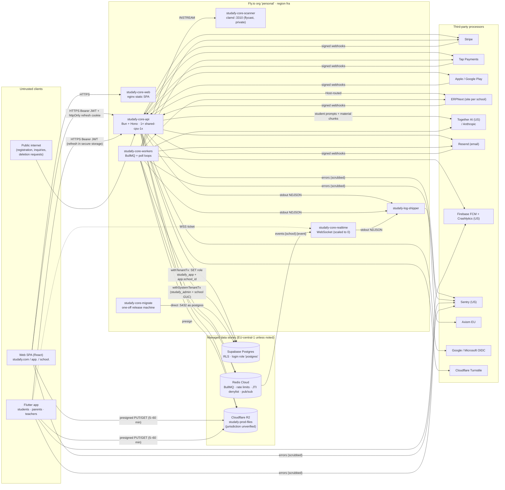

# 00 — Studafy system map (QA audit, Phase 0)

- **Date:** 2026-11-15
- **Branch audited:** `stage` @ `8c96850a`. The local `origin/dev` ref is from 2026-11-13; `stage` is 176 commits ahead of it.
- **Method:** read-only. I used Graphify (refreshed with `graphify update .`) to locate code, then read the code itself. Tooling ran locally only. A live route × role probe ran against a disposable, migrated test database. No production or Fly.io system was touched.

> **Corrections to the brief.** The task description was checked against the code, and these points differ:
>
> - **Postgres is not on Fly.** It is **Supabase** (AWS eu-central-1, transaction pooler on :6543). Redis is **Redis Cloud** (eu-central-1). Object storage is **Cloudflare R2** (via the S3 SDK).
> - **The database has far more than 39 tables:** about **216 `app` tables**, 240 relations including partitions. **222/240** are tenant-scoped under FORCE RLS (`db:test:rls-coverage` PASS).
> - **There is no TOTP MFA in the code at all.** Sign-in is Google/Microsoft OIDC, member ID + password (Argon2id, Bun defaults), review/QA shared-password logins (QA refused in prod), and guardian-issued child sessions.
> - **There is no self-serve parent↔student or class-join code.** Admins create parent links. School invites use 256-bit invitation tokens.
> - **The mobile app id is `com.studafy.studafy_mobile` (Android) / `com.studafy.studafyMobile` (iOS),** not `com.studafy.light`. "Studafy Light" appears nowhere in the repo (see QA-079).
> - **Payment providers:** Stripe, **Tap Payments** (MENA), and **Apple App Store / Google Play** in-app purchases for the AI add-on. School fees and invoicing go through **ERPNext**.
> - **AWS is decommissioned in code.** A Terraform state bucket and local `infra/terraform/` (814 MB, gitignored) remain (QA-071).
> - **The production deploy runs from `dev`.** `stage` holds fixes that are not on `dev` (QA-019).

---

## 1. Repository map

| Path                        | What it is                                                                                                                                                                                                                                                                                                                                        | Entry point                                    |
| --------------------------- | ------------------------------------------------------------------------------------------------------------------------------------------------------------------------------------------------------------------------------------------------------------------------------------------------------------------------------------------------- | ---------------------------------------------- |
| `apps/api`                  | Bun + Hono REST API (`@hono/zod-openapi`), **548 paths / 690 operations**                                                                                                                                                                                                                                                                         | `src/index.ts` → `createApp()` in `src/app.ts` |
| `apps/workers`              | BullMQ workers + polling loops (outbox relay, email, push, entitlements)                                                                                                                                                                                                                                                                          | `src/index.ts`, `src/registry.ts`              |
| `apps/realtime`             | WebSocket gateway (rooms per school/role/user, Redis pub/sub fan-out). **No DB access.**                                                                                                                                                                                                                                                          | `src/index.ts`                                 |
| `apps/web`                  | React + Vite SPA (public site, school portal, admin/principal/finance, platform console) served by nginx                                                                                                                                                                                                                                          | `src/main.tsx`                                 |
| `apps/mobile`               | Flutter app (students, parents, teachers)                                                                                                                                                                                                                                                                                                         | `lib/main.dart`                                |
| `apps/docs-api`             | API docs site                                                                                                                                                                                                                                                                                                                                     | —                                              |
| `packages/*` (23)           | Domain packages, including: `db` (migration runner, RLS coverage, partitions), `billing` (webhook state machine), `records` (AES-256-GCM sealing), `constants` (roles/permissions), `sanitize`, `announcements`, `grading-engine`, `ocr`, `tap-payments`, `license-pricing`, `*-reporting`, `student-import`, `observability`, `ui`, `api-client` | —                                              |
| `db/migrations`             | **214** forward migrations (`000001`…`000225`)                                                                                                                                                                                                                                                                                                    | `bun run db:migrate`                           |
| `db/policies`               | Canonical RLS policies + `rls-coverage.ts` CI audit                                                                                                                                                                                                                                                                                               | `bun run db:test:rls-coverage`                 |
| `infra/fly/*.toml`          | 7 Fly apps (see §4)                                                                                                                                                                                                                                                                                                                               | `.github/workflows/fly-production-deploy.yml`  |
| `infra/docker/*.Dockerfile` | api, web, workers, realtime, migrations, clamav, erpnext                                                                                                                                                                                                                                                                                          | —                                              |
| `.github/workflows`         | `ci.yml`, `containers.yml`, `e2e-critical.yml`, `fly-production-deploy.yml`, `mobile-integration.yml`, `mobile-release.yml`, `secrets-rotation-schedule.yml`, `web-performance.yml`                                                                                                                                                               | —                                              |

**API middleware order** (`app.ts:461-581`): requestId → CORS (exact-origin allowlist) → security headers (HSTS 2y preload, strict CSP) → CSRF (double-submit for non-Bearer mutating requests) → `jwtAuth` on `/api/*` (skips `DEFAULT_PUBLIC_PATHS`) → tenant-lifecycle / account-deletion / legal-acceptance guards → rate limiter (Redis token buckets) → route modules (34 under `src/modules`). Authorization combines `requirePermission(PERMISSIONS.X)` against `ROLE_PERMISSIONS` (`packages/constants/src/permissions.ts`), in-handler `requirePermissionIn`, `requireChannel`, and Postgres RLS (tenant isolation + restrictive role-scope policies).

**Roles** (`packages/constants/src/roles.ts`): `SUPER_ADMIN` (platform operator), `SUPPORT_AGENT` (platform tenant only), `ORG_ADMIN` (school admin), `PRINCIPAL`, `FINANCE`, `ATTENDANCE_OFFICER`, `INSTRUCTOR` (teacher), `STUDENT`, `PARENT`, `GUEST`.

## 2. Phase-0 tooling results

| Check                     | Command                                           | Result                                                                                                                                                                                                                                                                                                                                                                                                    |
| ------------------------- | ------------------------------------------------- | --------------------------------------------------------------------------------------------------------------------------------------------------------------------------------------------------------------------------------------------------------------------------------------------------------------------------------------------------------------------------------------------------------- |
| Install                   | `bun install --frozen-lockfile`                   | ✅                                                                                                                                                                                                                                                                                                                                                                                                        |
| Typecheck                 | `turbo run check-types --filter=!@studafy/mobile` | ✅ 0 errors                                                                                                                                                                                                                                                                                                                                                                                               |
| Lint                      | `turbo run lint --filter=!@studafy/mobile`        | ✅ 0 errors                                                                                                                                                                                                                                                                                                                                                                                               |
| Unit tests (no DB)        | `turbo run test`                                  | ✅ 49/49 tasks. **Note:** without `TEST_DATABASE_URL` every DB test silently skips (QA-004).                                                                                                                                                                                                                                                                                                              |
| API security suite (DB)   | `bun run test:security`                           | ✅ 798 pass / 0 fail                                                                                                                                                                                                                                                                                                                                                                                      |
| API auth suite (DB)       | `bun run test:auth`                               | ✅ 258 pass / 0 fail                                                                                                                                                                                                                                                                                                                                                                                      |
| API full suite (DB)       | `bun test` in `apps/api`                          | ✅ 4187 pass / 29 skip / 0 fail (326 files)                                                                                                                                                                                                                                                                                                                                                               |
| DB package + RLS coverage | `packages/db: bun test`, `rls-coverage`           | ✅ 168 pass / 8 skip; RLS PASS 222/240, p95 27 ms                                                                                                                                                                                                                                                                                                                                                         |
| Workers (DB)              | `apps/workers: bun test`                          | ✅ 558 pass / 9 skip (one run failed only because I set `DATABASE_SSL_MODE=disable`, a harness artefact)                                                                                                                                                                                                                                                                                                  |
| Route × role probe        | 690 ops × (anon + 10 roles) × web/mobile          | **0 HTTP 500s.** All 5xx were 503s from dependencies the harness doesn't configure. GUEST/STUDENT/PARENT got past the gate on routes that use RLS-only or object-level checks; triaged into QA-008, QA-011, QA-013, QA-086.                                                                                                                                                                               |
| Dependency audit          | `bun audit`                                       | 21 vulnerable packages. **Runtime:** `hono@4.12.34` (10 advisories incl. _RegExpRouter skips wildcard middleware_), `sanitize-html@2.17.7` (3 XSS bypasses), `react-router@6.30.6` (open redirect), `firebase-admin` → `@grpc/grpc-js` (high), `@fastify/busboy`, `fast-xml-parser`. The rest are dev/CI-only (storybook, @lhci, vite, happy-dom, fast-uri via openapi validator). See QA-041 and QA-073. |
| Secret scan, history      | `gitleaks git .` (repo `.gitleaks.toml`)          | 55 hits, **all false positives**: mobile test fixture passwords, `sk_test_placeholder` fixture, and file-hash entries in the tracked `graphify-out/cache/stat-index.json`. Not allowlisted, so a full-history scan fails (QA-075).                                                                                                                                                                        |
| Secret scan, tree         | ignored files on disk                             | `prod-secrets.json` and `prod-secerts.json` (gitignored, never committed, contents not opened), `.env`, `google-services.json`, `infra/terraform/`. **None is excluded by `.dockerignore`** (QA-021).                                                                                                                                                                                                     |
| Flutter analyze           | `flutter analyze`                                 | The first run reported 122 issues, all from the stale, gitignored generated Dart client: test files referenced models it didn't have (`ClassAiMaterialsSetting`, …). After `bun run mobile:client:generate`, **✅ no issues (exit 0)**. Making that step automatic is part of QA-004.                                                                                                                     |
| Flutter tests             | `flutter test` (after client regen)               | ✅ 1208 pass / 16 skip, includes `test/store_compliance/*`                                                                                                                                                                                                                                                                                                                                                |
| Flutter pub outdated      | `flutter pub outdated`                            | Ran; no security-relevant pins found.                                                                                                                                                                                                                                                                                                                                                                     |
| Local env friction        | —                                                 | `db:up` failed on a stale container name; the root `.env` `DATABASE_*` vars conflict with `DATABASE_URL`; the local test password differs from CI's; `db:migrate` resolves `db/migrations` relative to cwd. All of these are recorded in QA-004.                                                                                                                                                          |

## 3. Architecture & data flow



**Key flows**

- **Upload:** `request-upload` (MIME/size/permission/quota) → presigned PUT to `temp/<school>/<uuid>/…` → `confirm` (HEAD real size/type, `reserveStorage`, CopyObject to `permanent/…`) → row `scan_status='scanning'` → `scan` queue → clamd INSTREAM → `clean | quarantined | failed`. It fails closed. Downloads are presigned GETs for 5 minutes, `attachment` unless the type is inline-safe. **Exception:** learning materials PUT straight to a permanent, filename-derived key (QA-009).
- **Payments:** provider webhook → raw-body signature check → `withSystemTx` (as `studafy_admin`) → `processBillingEvent` (claim `(provider,event_id)` → classify → attribute school → arm RLS → fold ordered history → apply transition → audit → publish entitlement change) → retries on the `billing` queue.
- **Events:** transactional outbox (`app.outbox_events`) → relay loop → Redis pub/sub → realtime rooms, plus the email dispatcher (Resend, idempotency key) and the push consumer (FCM).
- **AI:** `/api/ai/students/:id/*`, self-gated (`aiStudentSelfGate`), with a token budget per student and month (fails closed). Retrieval is lexical/hybrid over `material_chunks` (embeddings are a deterministic mock). Grading of quizzes and exams is deterministic, not LLM. Material ingestion: parse → OCR (local Tesseract) → chunk.

## 4. Infrastructure (from config only, nothing live was queried)

| Fly app               | Role               | Exposure                                | Size                        | Notes                                                                          |
| --------------------- | ------------------ | --------------------------------------- | --------------------------- | ------------------------------------------------------------------------------ |
| studafy-core-api      | API                | Public `api.studafy.com`, `force_https` | shared-cpu-1x / 1 GB, min 1 | `/readyz` check every 15 s; no `[http_service.concurrency]`; no `kill_timeout` |
| studafy-core-web      | nginx SPA          | Public: studafy.com, www, app, school   | shared-cpu-1x / 256 MB      | Security headers lost on HTML locations; no CSP/HSTS (QA-052)                  |
| studafy-core-realtime | WS gateway         | Public service, currently unrouted      | 512 MB, scaled to 0         | —                                                                              |
| studafy-core-workers  | Queues + loops     | No services                             | shared-cpu-1x / 2 GB        | No `[checks]`, no `kill_timeout` (QA-047)                                      |
| studafy-core-scanner  | clamd              | Flycast private only, :3310, no auth    | 2 GB, auto-stop min 0       | Reachable from every app in org `personal` (QA-072)                            |
| studafy-core-migrate  | Migrations release | None                                    | 512 MB                      | Runs as `postgres` directly on :5432; no `lock_timeout` (QA-049)               |
| studafy-log-shipper   | Logs → Axiom EU    | None                                    | 256 MB                      | Deployed by hand                                                               |

- **CI:** `ci.yml` runs cross-tenant security probe, API integration, DB migrations + RLS audit, a11y, mobile client drift, Trivy fs, Semgrep (PR diff), Gitleaks (history), and quality (format/lint/types/build/test/OpenAPI drift). `containers.yml` builds images, generates an SBOM and runs Trivy (CRITICAL gate).
- **Deploy:** **manual `workflow_dispatch` with no CI gate and no ref allow-list** (QA-005). It stages secrets, then deploys scanner → migrations → api/realtime/workers/web, then smoke-tests `/healthz`.
- **Observability:** Sentry (server, web, mobile; `sendDefaultPii:false` plus scrubbers), Crashlytics, Axiom EU logs (no PII redaction, QA-020), Prometheus endpoints with nothing scraping them. **There are no alert rules, uptime monitors or paging** (QA-046).
- **DR:** `docs/architecture/SAD_30_backup_policy.md` and `docs/runbooks/dr/README.md` list RPO/RTO, PITR, R2 versioning and the restore drill as **"Not yet defined / Not met"** (QA-045).

## 5. Trust boundaries

| #   | Boundary                                    | Enforced by                                                                                              | Weak points found                                                                                                                                                                                                                                                                                               |
| --- | ------------------------------------------- | -------------------------------------------------------------------------------------------------------- | --------------------------------------------------------------------------------------------------------------------------------------------------------------------------------------------------------------------------------------------------------------------------------------------------------------- |
| TB1 | Internet → web/API edge                     | Fly edge TLS, `force_https`, CORS allowlist, CSRF, rate limits keyed on `Fly-Client-IP`                  | IP-keyed auth limits throttle a whole school behind campus NAT (QA-028); limiters fail open when Redis is down; `clientIpFrom` falls back to a forgeable `X-Forwarded-For` if the trusted header is missing (QA-086)                                                                                            |
| TB2 | Anonymous → authenticated                   | RS256 JWT (alg pinned, kid, iss/aud, zod claims), Redis JTI denylist (fails closed), entitlement version | Suspended users can sign in again over OAuth (QA-010); public school self-registration activates a school with no review (QA-007); ID-token replay on `/login/oauth` (QA-025)                                                                                                                                   |
| TB3 | Role → permission                           | `requirePermission` / `requirePermissionIn` / `requireChannel`                                           | Routes with no guard at all: materials (QA-008), expense attachments (QA-011), school checkout (QA-013). The guard-coverage test checks per file, not per route (QA-001). Channel is client-chosen (QA-085).                                                                                                    |
| TB4 | Within a school: user → object (horizontal) | Restrictive RLS role-scope policies (`can_read_student`, `teaches_class`, …) + service `assert*`         | Discipline incidents have tenant isolation only (QA-039); writes that rely only on the RLS readable set (QA-008, QA-087); FINANCE reads grades via the audit log (QA-040)                                                                                                                                       |
| TB5 | School A → school B (tenant)                | FORCE RLS `tenant_isolation`, transaction-local GUCs, fail-closed on unset GUC, CI coverage audit        | **The runtime login is Supabase `postgres` (probably BYPASSRLS); some code depends on that** (QA-014). Routine `SET ROLE studafy_admin`, the table owner (QA-015). `app.schools` is writable across tenants (QA-016). ERPNext webhook takes `school_id` from the payload under one shared HMAC secret (QA-034). |
| TB6 | Client → object storage                     | Presigned URLs, `assertSchoolOwnedKey`, scan gating, `attachment` disposition                            | Materials re-PUT after scan; confirm TOCTOU; no size bound on presigned PUT (QA-009, QA-036)                                                                                                                                                                                                                    |
| TB7 | Backend → third parties (PII egress)        | Sentry scrubbing, no user id to the LLM, Axiom EU                                                        | Raw query strings (with secrets) logged on `dev`/prod (QA-019); no PII redaction in logs (QA-020); minors' prompts sent to a US LLM; unmoderated raw LLM gateway (QA-030); US transfers need a legal basis (QA-077)                                                                                             |
| TB8 | Device → backend (mobile)                   | Secure storage (Keychain `first_unlock_this_device`), system-browser OAuth + PKCE, intent-bound redirect | Offline cache unencrypted and included in OS backups (QA-080); file caches survive account switch (QA-081)                                                                                                                                                                                                      |
| TB9 | Operator / CI → production                  | GitHub `prod` environment, Fly tokens                                                                    | No CI gate or ref restriction on deploy; mobile signing secrets are repo-wide; actions pinned by tag (QA-005, QA-006)                                                                                                                                                                                           |

## 6. Authentication flow

```mermaid
sequenceDiagram
  autonumber
  participant C as Client (web / mobile)
  participant A as API
  participant I as Google / Microsoft
  participant P as Postgres (RLS)
  participant R as Redis

  alt OIDC (staff, parents)
    C->>A: GET /api/auth/oauth/{p}/start (web) or /mobile-start
    A->>R: store state + nonce + PKCE verifier (GETDEL, 5 min TTL)
    A-->>C: 302 to IdP (+ browser-binding cookie on web)
    C->>I: authenticate
    I-->>A: /callback?code&state
    A->>I: code + PKCE → ID token (iss/aud/nonce/email_verified checked)
    A->>P: app.resolve_oauth_identity_for_login(provider, sub)  [SECURITY DEFINER]
    Note over A,P: ⚠ users.status is not checked here or in issueTokenPair (QA-010)
  else Member ID + password (students, parents, teachers)
    C->>A: POST /api/auth/login/member {code, password, channel}
    A->>R: rate-limit buckets (per IP, per username, global)
    A->>P: resolve_member_code_for_login → argon2id verify (constant-time branches), lockout 5/15 min
  end
  A->>P: issueTokenPair: roles + claims, insert refresh_tokens(hash, family)
  A-->>C: RS256 access JWT (900 s, in-memory key per process ⚠ QA-023)<br/>web: refresh in httpOnly SameSite=Strict cookie · mobile/api: refresh in body
  loop each request
    C->>A: Authorization: Bearer <jwt>
    A->>A: verify alg/kid/iss/aud/claims
    A->>R: JTI denylist + entitlement version (fail closed → 503)
    A->>P: withTenantTx: set_config(role=studafy_app, app.school_id, app.user_id)
  end
  C->>A: POST /api/auth/refresh
  A->>P: rotateRefreshToken (FOR UPDATE): reuse → revoke family + denylist
  Note over A,P: ⚠ no users.status re-check (QA-010); concurrent tabs trip reuse (QA-033)
  C->>A: logout / revoke session / admin deactivate
  A->>P: revoked_at + audit
  A->>R: denylist live access JTIs
```

The parent → child session path (`/api/auth/guardian/children/{studentId}/session`) issues a child-scoped session after checking the guardian link and the child's lock state. Realtime uses a short HS256 ticket from `POST /api/realtime/tickets`. It is single-use (Redis NX), denylist-checked at admit and by a periodic sweep, and closed at the session's `exp`.

## 7. API endpoint inventory

The source of truth is `apps/api/openapi.json`, regenerated on 2026-11-15. It has 690 operations: **643 Bearer JWT, 35 public, 8 public with provider signature (webhooks), 4 applicant cookie.**

The table below is generated from a live probe on 2026-11-15: 690 operations from `apps/api/openapi.json` × anonymous + 10 roles × web/mobile channel, against a disposable migrated test DB (scratch probe, not committed).

**Roles past gate** lists the callers that were _not_ answered 401/403 when using a placeholder object ID. It shows the authentication, permission and channel gates only. Object-level checks (RLS, `assert*` in services) can still deny with 404, and a 400 can mean body validation ran before an in-handler permission check (see QA-086). Abbreviations: SA=SUPER_ADMIN, OA=ORG_ADMIN, PR=PRINCIPAL, AO=ATTENDANCE_OFFICER, FI=FINANCE, IN=INSTRUCTOR, ST=STUDENT, PA=PARENT, GU=GUEST, SU=SUPPORT_AGENT.

#### AI (27)

| Method | Path                                                          | Auth       | Roles past gate |
| ------ | ------------------------------------------------------------- | ---------- | --------------- |
| GET    | `/api/ai/admin/metrics`                                       | Bearer JWT | all roles       |
| DELETE | `/api/ai/consent`                                             | Bearer JWT | all roles       |
| GET    | `/api/ai/consent`                                             | Bearer JWT | all roles       |
| PUT    | `/api/ai/consent`                                             | Bearer JWT | all roles       |
| GET    | `/api/ai/moderation/reports`                                  | Bearer JWT | all roles       |
| GET    | `/api/ai/moderation/reports/{reportId}`                       | Bearer JWT | all roles       |
| PATCH  | `/api/ai/moderation/reports/{reportId}`                       | Bearer JWT | all roles       |
| POST   | `/api/ai/students/{studentId}/ask`                            | Bearer JWT | all roles       |
| POST   | `/api/ai/students/{studentId}/concepts`                       | Bearer JWT | all roles       |
| GET    | `/api/ai/students/{studentId}/conversations`                  | Bearer JWT | all roles       |
| GET    | `/api/ai/students/{studentId}/conversations/{conversationId}` | Bearer JWT | all roles       |
| POST   | `/api/ai/students/{studentId}/decks`                          | Bearer JWT | all roles       |
| GET    | `/api/ai/students/{studentId}/decks/{deckId}/review`          | Bearer JWT | all roles       |
| POST   | `/api/ai/students/{studentId}/decks/{deckId}/review`          | Bearer JWT | all roles       |
| POST   | `/api/ai/students/{studentId}/exams`                          | Bearer JWT | all roles       |
| GET    | `/api/ai/students/{studentId}/exams/{examId}`                 | Bearer JWT | all roles       |
| POST   | `/api/ai/students/{studentId}/exams/{examId}/start`           | Bearer JWT | all roles       |
| POST   | `/api/ai/students/{studentId}/exams/{examId}/submit`          | Bearer JWT | all roles       |
| POST   | `/api/ai/students/{studentId}/explain`                        | Bearer JWT | all roles       |
| POST   | `/api/ai/students/{studentId}/generate`                       | Bearer JWT | all roles       |
| POST   | `/api/ai/students/{studentId}/messages/{messageId}/report`    | Bearer JWT | all roles       |
| POST   | `/api/ai/students/{studentId}/quizzes`                        | Bearer JWT | all roles       |
| POST   | `/api/ai/students/{studentId}/quizzes/{quizId}/grade`         | Bearer JWT | all roles       |
| POST   | `/api/ai/students/{studentId}/reports`                        | Bearer JWT | all roles       |
| POST   | `/api/ai/students/{studentId}/search`                         | Bearer JWT | all roles       |
| POST   | `/api/ai/students/{studentId}/summarize`                      | Bearer JWT | all roles       |
| GET    | `/api/ai/usage`                                               | Bearer JWT | all roles       |

#### Academic grading (27)

| Method | Path                                                              | Auth       | Roles past gate |
| ------ | ----------------------------------------------------------------- | ---------- | --------------- |
| POST   | `/api/grading/exam-structure/apply`                               | Bearer JWT | SA, OA, PR      |
| DELETE | `/api/grading/scales/{scaleId}`                                   | Bearer JWT | SA, OA, PR      |
| PUT    | `/api/grading/scales/{scaleId}`                                   | Bearer JWT | SA, OA, PR      |
| GET    | `/api/grading/sections/{sectionId}/subject-enrollments`           | Bearer JWT | SA, OA, PR, IN  |
| PUT    | `/api/grading/sections/{sectionId}/subject-enrollments`           | Bearer JWT | SA, OA, PR      |
| GET    | `/api/grading/sections/{sectionId}/subjects`                      | Bearer JWT | SA, OA, PR, IN  |
| POST   | `/api/grading/sections/{sectionId}/subjects/{subjectId}/override` | Bearer JWT | SA, OA, PR      |
| DELETE | `/api/grading/subject-configs/{configId}`                         | Bearer JWT | SA, OA, PR      |
| GET    | `/api/grading/subject-configs/{configId}`                         | Bearer JWT | SA, OA, PR, IN  |
| PUT    | `/api/grading/subject-configs/{configId}`                         | Bearer JWT | SA, OA, PR      |
| GET    | `/api/grading/subject-configs/{configId}/impact`                  | Bearer JWT | SA, OA, PR, IN  |
| POST   | `/api/grading/subject-configs/{configId}/keep`                    | Bearer JWT | SA, OA, PR      |
| POST   | `/api/grading/subject-configs/{configId}/reset`                   | Bearer JWT | SA, OA, PR      |
| POST   | `/api/grading/teacher-assignments`                                | Bearer JWT | SA, OA, PR      |
| DELETE | `/api/grading/teacher-assignments/{assignmentId}`                 | Bearer JWT | SA, OA, PR      |
| POST   | `/api/grading/years/{yearId}/copy`                                | Bearer JWT | SA, OA, PR      |
| GET    | `/api/grading/years/{yearId}/exam-template`                       | Bearer JWT | SA, OA, PR, IN  |
| GET    | `/api/grading/years/{yearId}/overview`                            | Bearer JWT | SA, OA, PR, IN  |
| GET    | `/api/grading/years/{yearId}/programs`                            | Bearer JWT | SA, OA, PR, IN  |
| PUT    | `/api/grading/years/{yearId}/programs/{gradeLevelId}`             | Bearer JWT | SA, OA, PR      |
| GET    | `/api/grading/years/{yearId}/programs/{gradeLevelId}/subjects`    | Bearer JWT | SA, OA, PR, IN  |
| POST   | `/api/grading/years/{yearId}/programs/{gradeLevelId}/subjects`    | Bearer JWT | SA, OA, PR      |
| GET    | `/api/grading/years/{yearId}/publish-check`                       | Bearer JWT | SA, OA, PR, IN  |
| GET    | `/api/grading/years/{yearId}/scales`                              | Bearer JWT | SA, OA, PR, IN  |
| POST   | `/api/grading/years/{yearId}/scales`                              | Bearer JWT | SA, OA, PR      |
| POST   | `/api/grading/years/{yearId}/status`                              | Bearer JWT | SA, OA, PR      |
| GET    | `/api/grading/years/{yearId}/teacher-assignments`                 | Bearer JWT | SA, OA, PR, IN  |

#### Academics (60)

| Method | Path                                                             | Auth       | Roles past gate                       |
| ------ | ---------------------------------------------------------------- | ---------- | ------------------------------------- |
| GET    | `/api/academics/classes`                                         | Bearer JWT | all roles                             |
| POST   | `/api/academics/classes`                                         | Bearer JWT | SA, OA, PR                            |
| DELETE | `/api/academics/classes/{classId}`                               | Bearer JWT | SA, OA, PR                            |
| GET    | `/api/academics/classes/{classId}`                               | Bearer JWT | all roles                             |
| PATCH  | `/api/academics/classes/{classId}`                               | Bearer JWT | SA, OA, PR                            |
| GET    | `/api/academics/classes/{classId}/ai-materials`                  | Bearer JWT | all roles                             |
| PUT    | `/api/academics/classes/{classId}/ai-materials`                  | Bearer JWT | SA, OA, PR, IN                        |
| GET    | `/api/academics/classes/{classId}/enrollments`                   | Bearer JWT | all roles                             |
| POST   | `/api/academics/classes/{classId}/enrollments`                   | Bearer JWT | SA, OA, PR                            |
| POST   | `/api/academics/classes/{classId}/enrollments/transfer`          | Bearer JWT | SA, OA, PR                            |
| DELETE | `/api/academics/classes/{classId}/enrollments/{studentId}`       | Bearer JWT | SA, OA, PR                            |
| GET    | `/api/academics/classes/{classId}/students/{studentId}/overview` | Bearer JWT | none in tenant (operator/system only) |
| DELETE | `/api/academics/courses/{courseId}`                              | Bearer JWT | SA, OA, PR                            |
| GET    | `/api/academics/courses/{courseId}`                              | Bearer JWT | all roles                             |
| PATCH  | `/api/academics/courses/{courseId}`                              | Bearer JWT | SA, OA, PR                            |
| GET    | `/api/academics/exams`                                           | Bearer JWT | all roles                             |
| POST   | `/api/academics/exams`                                           | Bearer JWT | SA, OA, PR                            |
| DELETE | `/api/academics/exams/{examId}`                                  | Bearer JWT | SA, OA, PR                            |
| GET    | `/api/academics/exams/{examId}`                                  | Bearer JWT | all roles                             |
| PATCH  | `/api/academics/exams/{examId}`                                  | Bearer JWT | SA, OA, PR                            |
| GET    | `/api/academics/grade-levels`                                    | Bearer JWT | all roles                             |
| POST   | `/api/academics/grade-levels`                                    | Bearer JWT | SA, OA, PR                            |
| DELETE | `/api/academics/grade-levels/{gradeLevelId}`                     | Bearer JWT | SA, OA, PR                            |
| PATCH  | `/api/academics/grade-levels/{gradeLevelId}`                     | Bearer JWT | SA, OA, PR                            |
| GET    | `/api/academics/materials`                                       | Bearer JWT | all roles                             |
| POST   | `/api/academics/materials/upload`                                | Bearer JWT | all roles                             |
| DELETE | `/api/academics/materials/{materialId}`                          | Bearer JWT | all roles                             |
| GET    | `/api/academics/materials/{materialId}`                          | Bearer JWT | all roles                             |
| PATCH  | `/api/academics/materials/{materialId}`                          | Bearer JWT | all roles                             |
| PATCH  | `/api/academics/materials/{materialId}/ai-visible`               | Bearer JWT | all roles                             |
| POST   | `/api/academics/materials/{materialId}/confirm`                  | Bearer JWT | all roles                             |
| POST   | `/api/academics/promotions/apply`                                | Bearer JWT | SA, OA, PR                            |
| GET    | `/api/academics/promotions/preview`                              | Bearer JWT | SA, OA, PR                            |
| GET    | `/api/academics/rooms`                                           | Bearer JWT | all roles                             |
| GET    | `/api/academics/sections`                                        | Bearer JWT | all roles                             |
| POST   | `/api/academics/sections`                                        | Bearer JWT | SA, OA, PR                            |
| DELETE | `/api/academics/sections/{sectionId}`                            | Bearer JWT | SA, OA, PR                            |
| GET    | `/api/academics/sections/{sectionId}`                            | Bearer JWT | all roles                             |
| PATCH  | `/api/academics/sections/{sectionId}`                            | Bearer JWT | SA, OA, PR                            |
| GET    | `/api/academics/sections/{sectionId}/students`                   | Bearer JWT | SA, OA, PR                            |
| POST   | `/api/academics/sections/{sectionId}/students`                   | Bearer JWT | SA, OA, PR                            |
| DELETE | `/api/academics/sections/{sectionId}/students/{studentId}`       | Bearer JWT | SA, OA, PR                            |
| GET    | `/api/academics/subjects`                                        | Bearer JWT | all roles                             |
| POST   | `/api/academics/subjects`                                        | Bearer JWT | SA, OA, PR                            |
| DELETE | `/api/academics/subjects/{subjectId}`                            | Bearer JWT | SA, OA, PR                            |
| GET    | `/api/academics/subjects/{subjectId}`                            | Bearer JWT | all roles                             |
| PATCH  | `/api/academics/subjects/{subjectId}`                            | Bearer JWT | SA, OA, PR                            |
| GET    | `/api/academics/subjects/{subjectId}/courses`                    | Bearer JWT | all roles                             |
| POST   | `/api/academics/subjects/{subjectId}/courses`                    | Bearer JWT | SA, OA, PR                            |
| DELETE | `/api/academics/terms/{termId}`                                  | Bearer JWT | SA, OA, PR                            |
| GET    | `/api/academics/terms/{termId}`                                  | Bearer JWT | all roles                             |
| PATCH  | `/api/academics/terms/{termId}`                                  | Bearer JWT | SA, OA, PR                            |
| GET    | `/api/academics/years`                                           | Bearer JWT | all roles                             |
| POST   | `/api/academics/years`                                           | Bearer JWT | SA, OA, PR                            |
| DELETE | `/api/academics/years/{yearId}`                                  | Bearer JWT | SA, OA, PR                            |
| GET    | `/api/academics/years/{yearId}`                                  | Bearer JWT | all roles                             |
| PATCH  | `/api/academics/years/{yearId}`                                  | Bearer JWT | SA, OA, PR                            |
| POST   | `/api/academics/years/{yearId}/rollover`                         | Bearer JWT | SA, OA, PR                            |
| GET    | `/api/academics/years/{yearId}/terms`                            | Bearer JWT | all roles                             |
| POST   | `/api/academics/years/{yearId}/terms`                            | Bearer JWT | SA, OA, PR                            |

#### Account (6)

| Method | Path                                     | Auth       | Roles past gate       |
| ------ | ---------------------------------------- | ---------- | --------------------- |
| DELETE | `/api/account/deletion`                  | Bearer JWT | all roles             |
| POST   | `/api/account/deletion`                  | Bearer JWT | all roles             |
| POST   | `/api/account/deletion-requests`         | Public     | any (incl. anonymous) |
| POST   | `/api/account/deletion-requests/confirm` | Public     | any (incl. anonymous) |
| POST   | `/api/account/legal-acceptance`          | Bearer JWT | all roles             |
| GET    | `/api/account/profile`                   | Bearer JWT | all roles             |

#### Admin (5)

| Method | Path                                             | Auth       | Roles past gate |
| ------ | ------------------------------------------------ | ---------- | --------------- |
| DELETE | `/api/admin/users/{userId}/devices`              | Bearer JWT | SA, OA          |
| GET    | `/api/admin/users/{userId}/devices`              | Bearer JWT | SA, OA          |
| DELETE | `/api/admin/users/{userId}/devices/{deviceId}`   | Bearer JWT | SA, OA          |
| DELETE | `/api/admin/users/{userId}/providers/{provider}` | Bearer JWT | SA, OA          |
| GET    | `/api/admin/users/{userId}/sessions`             | Bearer JWT | SA, OA          |

#### Announcements (2)

| Method | Path                 | Auth       | Roles past gate |
| ------ | -------------------- | ---------- | --------------- |
| GET    | `/api/announcements` | Bearer JWT | SA, OA, PR      |
| POST   | `/api/announcements` | Bearer JWT | all roles       |

#### Approval Queue (2)

| Method | Path                           | Auth       | Roles past gate |
| ------ | ------------------------------ | ---------- | --------------- |
| POST   | `/api/approvals/bulk-decision` | Bearer JWT | SA, OA, PR      |
| GET    | `/api/approvals/queue`         | Bearer JWT | SA, OA, PR      |

#### Assignments (9)

| Method | Path                                                                   | Auth       | Roles past gate    |
| ------ | ---------------------------------------------------------------------- | ---------- | ------------------ |
| GET    | `/api/academics/assignments`                                           | Bearer JWT | SA, OA, IN, ST, PA |
| POST   | `/api/academics/assignments`                                           | Bearer JWT | SA, OA, IN         |
| DELETE | `/api/academics/assignments/{assignmentId}`                            | Bearer JWT | SA, OA, IN         |
| GET    | `/api/academics/assignments/{assignmentId}`                            | Bearer JWT | SA, OA, IN, ST, PA |
| PATCH  | `/api/academics/assignments/{assignmentId}`                            | Bearer JWT | SA, OA, IN         |
| POST   | `/api/academics/assignments/{assignmentId}/attachments`                | Bearer JWT | SA, OA, IN         |
| POST   | `/api/academics/assignments/{assignmentId}/attachments/upload-url`     | Bearer JWT | SA, OA, IN         |
| DELETE | `/api/academics/assignments/{assignmentId}/attachments/{attachmentId}` | Bearer JWT | SA, OA, IN         |
| PUT    | `/api/academics/assignments/{assignmentId}/questions`                  | Bearer JWT | SA, OA, IN         |

#### Attendance (10)

| Method | Path                                           | Auth       | Roles past gate    |
| ------ | ---------------------------------------------- | ---------- | ------------------ |
| GET    | `/api/attendance/classes/{classId}/roster`     | Bearer JWT | SA, OA, PR, AO, IN |
| POST   | `/api/attendance/records/batch`                | Bearer JWT | SA, AO, IN         |
| PATCH  | `/api/attendance/records/{recordId}`           | Bearer JWT | SA, PR, AO, IN     |
| GET    | `/api/attendance/records/{recordId}/history`   | Bearer JWT | SA, OA, PR, AO, IN |
| GET    | `/api/attendance/sessions`                     | Bearer JWT | all roles          |
| POST   | `/api/attendance/sessions`                     | Bearer JWT | SA, AO, IN         |
| GET    | `/api/attendance/sessions/{sessionId}`         | Bearer JWT | all roles          |
| PATCH  | `/api/attendance/sessions/{sessionId}`         | Bearer JWT | SA, AO, IN         |
| GET    | `/api/attendance/sessions/{sessionId}/records` | Bearer JWT | SA, OA, PR, AO, IN |
| GET    | `/api/attendance/students/{studentId}/records` | Bearer JWT | SA, OA, PR, AO, IN |

#### Attendance Reports (4)

| Method | Path                                     | Auth       | Roles past gate    |
| ------ | ---------------------------------------- | ---------- | ------------------ |
| POST   | `/api/attendance/reports/export`         | Bearer JWT | SA, OA, PR, AO     |
| GET    | `/api/attendance/reports/export/{jobId}` | Bearer JWT | SA, OA, PR, AO     |
| GET    | `/api/attendance/reports/summary`        | Bearer JWT | SA, OA, PR, AO, IN |
| GET    | `/api/attendance/reports/trends`         | Bearer JWT | SA, OA, PR, AO, IN |

#### Audit Logs (3)

| Method | Path                             | Auth       | Roles past gate |
| ------ | -------------------------------- | ---------- | --------------- |
| GET    | `/api/audit/logs`                | Bearer JWT | SA, OA, FI, SU  |
| POST   | `/api/audit/logs/export`         | Bearer JWT | SA, OA, FI      |
| GET    | `/api/audit/logs/export/{jobId}` | Bearer JWT | SA, OA, FI      |

#### Auth (25)

| Method | Path                                              | Auth       | Roles past gate       |
| ------ | ------------------------------------------------- | ---------- | --------------------- |
| GET    | `/.well-known/jwks.json`                          | Public     | any (incl. anonymous) |
| GET    | `/api/auth/devices`                               | Bearer JWT | all roles             |
| POST   | `/api/auth/devices`                               | Bearer JWT | all roles             |
| DELETE | `/api/auth/devices/{deviceId}`                    | Bearer JWT | all roles             |
| DELETE | `/api/auth/devices/{deviceId}/sessions`           | Bearer JWT | all roles             |
| POST   | `/api/auth/guardian/children/{studentId}/session` | Bearer JWT | PA                    |
| POST   | `/api/auth/login/member`                          | Public     | any (incl. anonymous) |
| POST   | `/api/auth/login/oauth`                           | Public     | any (incl. anonymous) |
| POST   | `/api/auth/login/qa`                              | Public     | any (incl. anonymous) |
| POST   | `/api/auth/login/review`                          | Public     | any (incl. anonymous) |
| POST   | `/api/auth/logout`                                | Public     | any (incl. anonymous) |
| POST   | `/api/auth/oauth/google/mobile-exchange`          | Public     | any (incl. anonymous) |
| GET    | `/api/auth/oauth/google/mobile-start`             | Public     | any (incl. anonymous) |
| POST   | `/api/auth/oauth/microsoft/mobile-exchange`       | Public     | any (incl. anonymous) |
| GET    | `/api/auth/oauth/microsoft/mobile-start`          | Public     | any (incl. anonymous) |
| POST   | `/api/auth/oauth/mock/mobile-exchange`            | Public     | any (incl. anonymous) |
| GET    | `/api/auth/oauth/mock/mobile-start`               | Public     | any (incl. anonymous) |
| POST   | `/api/auth/password/change`                       | Bearer JWT | all roles             |
| GET    | `/api/auth/providers`                             | Bearer JWT | all roles             |
| POST   | `/api/auth/providers/link/start`                  | Bearer JWT | all roles             |
| DELETE | `/api/auth/providers/{provider}`                  | Bearer JWT | all roles             |
| POST   | `/api/auth/refresh`                               | Public     | any (incl. anonymous) |
| GET    | `/api/auth/sessions`                              | Bearer JWT | all roles             |
| POST   | `/api/auth/sessions/revoke-others`                | Bearer JWT | all roles             |
| DELETE | `/api/auth/sessions/{sessionId}`                  | Bearer JWT | all roles             |

#### Child Comparison Reports (3)

| Method | Path                                          | Auth       | Roles past gate                       |
| ------ | --------------------------------------------- | ---------- | ------------------------------------- |
| GET    | `/api/reports/children/comparison`            | Bearer JWT | SA, OA, PR, IN, ST, PA                |
| GET    | `/api/reports/children/{studentId}/breakdown` | Bearer JWT | SA, OA, PR, IN, ST, PA                |
| GET    | `/api/reports/children/{studentId}/timetable` | Bearer JWT | none in tenant (operator/system only) |

#### Custom lists (18)

| Method | Path                                                              | Auth       | Roles past gate        |
| ------ | ----------------------------------------------------------------- | ---------- | ---------------------- |
| GET    | `/api/custom-lists`                                               | Bearer JWT | SA, OA, PR, AO, FI, IN |
| POST   | `/api/custom-lists`                                               | Bearer JWT | SA, OA, PR             |
| POST   | `/api/custom-lists/imports/apply`                                 | Bearer JWT | SA, OA, PR             |
| POST   | `/api/custom-lists/imports/preview`                               | Bearer JWT | SA, OA, PR             |
| GET    | `/api/custom-lists/linked/{subjectKind}/{subjectId}`              | Bearer JWT | SA, OA, PR, AO, FI, IN |
| DELETE | `/api/custom-lists/{listId}`                                      | Bearer JWT | SA, OA, PR             |
| GET    | `/api/custom-lists/{listId}`                                      | Bearer JWT | SA, OA, PR, AO, FI, IN |
| PATCH  | `/api/custom-lists/{listId}`                                      | Bearer JWT | SA, OA, PR             |
| PUT    | `/api/custom-lists/{listId}/column-order`                         | Bearer JWT | SA, OA, PR             |
| POST   | `/api/custom-lists/{listId}/columns`                              | Bearer JWT | SA, OA, PR             |
| PATCH  | `/api/custom-lists/{listId}/columns/{columnId}`                   | Bearer JWT | SA, OA, PR             |
| GET    | `/api/custom-lists/{listId}/export`                               | Bearer JWT | SA, OA, PR, AO, FI, IN |
| GET    | `/api/custom-lists/{listId}/link-candidates`                      | Bearer JWT | SA, OA, PR, AO, FI, IN |
| GET    | `/api/custom-lists/{listId}/rows`                                 | Bearer JWT | SA, OA, PR, AO, FI, IN |
| POST   | `/api/custom-lists/{listId}/rows`                                 | Bearer JWT | SA, OA, PR, AO, FI, IN |
| DELETE | `/api/custom-lists/{listId}/rows/{rowId}`                         | Bearer JWT | SA, OA, PR, AO, FI, IN |
| PATCH  | `/api/custom-lists/{listId}/rows/{rowId}`                         | Bearer JWT | SA, OA, PR, AO, FI, IN |
| POST   | `/api/custom-lists/{listId}/rows/{rowId}/cells/{columnId}/reveal` | Bearer JWT | SA, OA, PR             |

#### Discipline (8)

| Method | Path                                                        | Auth       | Roles past gate        |
| ------ | ----------------------------------------------------------- | ---------- | ---------------------- |
| GET    | `/api/discipline/incidents`                                 | Bearer JWT | SA, OA, PR, IN, SU     |
| POST   | `/api/discipline/incidents`                                 | Bearer JWT | SA, OA, PR, IN, PA, SU |
| GET    | `/api/discipline/incidents/{incidentId}`                    | Bearer JWT | SA, OA, PR, IN, SU     |
| PATCH  | `/api/discipline/incidents/{incidentId}`                    | Bearer JWT | SA, OA, PR             |
| GET    | `/api/discipline/incidents/{incidentId}/actions`            | Bearer JWT | SA, OA, PR             |
| POST   | `/api/discipline/incidents/{incidentId}/actions`            | Bearer JWT | SA, OA, PR             |
| PATCH  | `/api/discipline/incidents/{incidentId}/actions/{actionId}` | Bearer JWT | SA, OA, PR             |
| POST   | `/api/discipline/incidents/{incidentId}/resolve`            | Bearer JWT | SA, OA, PR             |

#### ERPNext (1)

| Method | Path                | Auth                        | Roles past gate                       |
| ------ | ------------------- | --------------------------- | ------------------------------------- |
| POST   | `/erpnext/webhooks` | Public + provider signature | none in tenant (operator/system only) |

#### Email (1)

| Method | Path                     | Auth                        | Roles past gate                       |
| ------ | ------------------------ | --------------------------- | ------------------------------------- |
| POST   | `/email/webhooks/resend` | Public + provider signature | none in tenant (operator/system only) |

#### Evaluations (14)

| Method | Path                                                          | Auth       | Roles past gate |
| ------ | ------------------------------------------------------------- | ---------- | --------------- |
| GET    | `/api/evaluations`                                            | Bearer JWT | SA, OA, PR      |
| POST   | `/api/evaluations`                                            | Bearer JWT | SA, OA, PR      |
| GET    | `/api/evaluations/templates`                                  | Bearer JWT | SA, OA, PR      |
| POST   | `/api/evaluations/templates`                                  | Bearer JWT | SA, OA, PR      |
| DELETE | `/api/evaluations/templates/{templateId}`                     | Bearer JWT | SA, OA, PR      |
| GET    | `/api/evaluations/templates/{templateId}`                     | Bearer JWT | SA, OA, PR      |
| PATCH  | `/api/evaluations/templates/{templateId}`                     | Bearer JWT | SA, OA, PR      |
| GET    | `/api/evaluations/{evaluationId}`                             | Bearer JWT | SA, OA, PR      |
| PATCH  | `/api/evaluations/{evaluationId}`                             | Bearer JWT | SA, OA, PR      |
| GET    | `/api/evaluations/{evaluationId}/scores`                      | Bearer JWT | SA, OA, PR      |
| DELETE | `/api/evaluations/{evaluationId}/scores/{criteriaTemplateId}` | Bearer JWT | SA, OA, PR      |
| PUT    | `/api/evaluations/{evaluationId}/scores/{criteriaTemplateId}` | Bearer JWT | all roles       |
| POST   | `/api/evaluations/{evaluationId}/share`                       | Bearer JWT | SA, OA, PR      |
| POST   | `/api/evaluations/{evaluationId}/submit`                      | Bearer JWT | SA, OA, PR      |

#### Families (8)

| Method | Path                                                        | Auth       | Roles past gate |
| ------ | ----------------------------------------------------------- | ---------- | --------------- |
| GET    | `/api/families`                                             | Bearer JWT | SA, OA, PA      |
| POST   | `/api/families`                                             | Bearer JWT | SA, OA          |
| DELETE | `/api/families/{familyId}`                                  | Bearer JWT | SA, OA          |
| GET    | `/api/families/{familyId}`                                  | Bearer JWT | SA, OA, PA      |
| PATCH  | `/api/families/{familyId}`                                  | Bearer JWT | SA, OA          |
| POST   | `/api/families/{familyId}/links`                            | Bearer JWT | SA, OA          |
| DELETE | `/api/families/{familyId}/links/{parentUserId}/{studentId}` | Bearer JWT | SA, OA          |
| PATCH  | `/api/families/{familyId}/links/{parentUserId}/{studentId}` | Bearer JWT | SA, OA          |

#### Features (1)

| Method | Path               | Auth       | Roles past gate |
| ------ | ------------------ | ---------- | --------------- |
| GET    | `/api/me/features` | Bearer JWT | all roles       |

#### Finance (69)

| Method | Path                                                    | Auth                        | Roles past gate                       |
| ------ | ------------------------------------------------------- | --------------------------- | ------------------------------------- |
| GET    | `/api/finance/expenses`                                 | Bearer JWT                  | SA, OA, FI                            |
| POST   | `/api/finance/expenses`                                 | Bearer JWT                  | SA, OA, FI                            |
| GET    | `/api/finance/expenses/summary`                         | Bearer JWT                  | SA, OA, FI                            |
| POST   | `/api/finance/expenses/upload-url`                      | Bearer JWT                  | SA, OA, FI                            |
| GET    | `/api/finance/expenses/{expenseId}`                     | Bearer JWT                  | SA, OA, FI                            |
| PATCH  | `/api/finance/expenses/{expenseId}`                     | Bearer JWT                  | SA, OA, FI                            |
| POST   | `/api/finance/expenses/{expenseId}/attachments`         | Bearer JWT                  | all roles                             |
| GET    | `/api/finance/families`                                 | Bearer JWT                  | SA, OA, FI, SU                        |
| GET    | `/api/finance/families/{familyId}`                      | Bearer JWT                  | all roles                             |
| POST   | `/api/finance/families/{familyId}/payments`             | Bearer JWT                  | SA, OA, FI                            |
| GET    | `/api/finance/families/{familyId}/profile`              | Bearer JWT                  | SA, OA, FI, SU                        |
| POST   | `/api/finance/families/{familyId}/reminders`            | Bearer JWT                  | SA, OA, FI                            |
| POST   | `/api/finance/families/{familyId}/statements`           | Bearer JWT                  | SA, OA, FI                            |
| POST   | `/api/finance/fee-schedules/generate`                   | Bearer JWT                  | SA, OA, FI                            |
| GET    | `/api/finance/fee-structures`                           | Bearer JWT                  | SA, OA, FI                            |
| POST   | `/api/finance/fee-structures`                           | Bearer JWT                  | SA, OA, FI                            |
| PATCH  | `/api/finance/fee-structures/{feeStructureId}`          | Bearer JWT                  | SA, OA, FI                            |
| GET    | `/api/finance/fee-structures/{feeStructureId}/students` | Bearer JWT                  | SA, OA, FI, SU                        |
| PUT    | `/api/finance/fee-structures/{feeStructureId}/students` | Bearer JWT                  | SA, OA, FI                            |
| GET    | `/api/finance/invoices`                                 | Bearer JWT                  | SA, OA, FI, SU                        |
| GET    | `/api/finance/invoices/batches`                         | Bearer JWT                  | SA, OA, FI, SU                        |
| POST   | `/api/finance/invoices/batches`                         | Bearer JWT                  | SA, OA, FI, SU                        |
| POST   | `/api/finance/invoices/batches/preflight`               | Bearer JWT                  | SA, OA, FI, SU                        |
| GET    | `/api/finance/invoices/batches/{batchId}`               | Bearer JWT                  | SA, OA, FI, SU                        |
| GET    | `/api/finance/invoices/batches/{batchId}/items`         | Bearer JWT                  | SA, OA, FI, SU                        |
| GET    | `/api/finance/invoices/{invoiceId}`                     | Bearer JWT                  | SA, OA, FI, SU                        |
| POST   | `/api/finance/invoices/{invoiceId}/cancellation`        | Bearer JWT                  | SA, OA, FI                            |
| POST   | `/api/finance/online-payments`                          | Bearer JWT                  | all roles                             |
| GET    | `/api/finance/online-payments/{paymentId}`              | Bearer JWT                  | all roles                             |
| GET    | `/api/finance/payments`                                 | Bearer JWT                  | SA, OA, FI                            |
| POST   | `/api/finance/payments`                                 | Bearer JWT                  | SA, OA, FI                            |
| GET    | `/api/finance/payments/{paymentId}`                     | Bearer JWT                  | SA, OA, FI, SU                        |
| GET    | `/api/finance/payments/{paymentId}/receipt`             | Bearer JWT                  | SA, OA, FI, PA, SU                    |
| POST   | `/api/finance/payments/{paymentId}/reversal`            | Bearer JWT                  | SA, OA, FI                            |
| POST   | `/api/finance/reconciliation/run`                       | Bearer JWT                  | none in tenant (operator/system only) |
| GET    | `/api/finance/refunds`                                  | Bearer JWT                  | SA, OA, FI, SU                        |
| POST   | `/api/finance/refunds/initiate`                         | Bearer JWT                  | SA, OA, FI                            |
| GET    | `/api/finance/refunds/{refundId}`                       | Bearer JWT                  | SA, OA, FI, SU                        |
| POST   | `/api/finance/refunds/{refundId}/approve`               | Bearer JWT                  | SA, OA                                |
| POST   | `/api/finance/refunds/{refundId}/reject`                | Bearer JWT                  | SA, OA                                |
| POST   | `/api/finance/reminders`                                | Bearer JWT                  | SA, OA, FI                            |
| GET    | `/api/finance/reports/ar-aging`                         | Bearer JWT                  | SA, OA, FI                            |
| GET    | `/api/finance/reports/collections-by-method`            | Bearer JWT                  | SA, OA, FI                            |
| GET    | `/api/finance/reports/collections-vs-due`               | Bearer JWT                  | SA, OA, FI                            |
| POST   | `/api/finance/reports/export`                           | Bearer JWT                  | SA, OA, FI                            |
| GET    | `/api/finance/reports/export/{jobId}`                   | Bearer JWT                  | SA, OA, FI                            |
| GET    | `/api/finance/reports/family-statement/{familyId}`      | Bearer JWT                  | all roles                             |
| GET    | `/api/finance/reports/general-ledger`                   | Bearer JWT                  | SA, OA, FI                            |
| GET    | `/api/finance/reports/joinvoice/{invoiceId}`            | Bearer JWT                  | SA, OA, FI                            |
| GET    | `/api/finance/scholarship-awards`                       | Bearer JWT                  | SA, OA, FI, SU                        |
| POST   | `/api/finance/scholarship-awards`                       | Bearer JWT                  | SA, OA, FI                            |
| POST   | `/api/finance/scholarship-awards/{awardId}/approve`     | Bearer JWT                  | SA, OA                                |
| POST   | `/api/finance/scholarship-awards/{awardId}/reject`      | Bearer JWT                  | SA, OA                                |
| POST   | `/api/finance/scholarship-awards/{awardId}/revoke`      | Bearer JWT                  | SA, OA                                |
| GET    | `/api/finance/scholarships`                             | Bearer JWT                  | SA, OA, FI, SU                        |
| POST   | `/api/finance/scholarships`                             | Bearer JWT                  | SA, OA, FI                            |
| PATCH  | `/api/finance/scholarships/{scholarshipId}`             | Bearer JWT                  | SA, OA, FI                            |
| GET    | `/api/finance/sibling-discount`                         | Bearer JWT                  | SA, OA, FI, SU                        |
| PUT    | `/api/finance/sibling-discount`                         | Bearer JWT                  | SA, OA                                |
| GET    | `/api/finance/students`                                 | Bearer JWT                  | SA, OA, FI, SU                        |
| GET    | `/api/finance/students/{studentId}`                     | Bearer JWT                  | SA, OA, FI, SU                        |
| GET    | `/api/finance/students/{studentId}/installments`        | Bearer JWT                  | SA, OA, FI, SU                        |
| GET    | `/api/finance/tax-settings`                             | Bearer JWT                  | SA, OA, FI, SU                        |
| PUT    | `/api/finance/tax-settings`                             | Bearer JWT                  | SA, OA                                |
| GET    | `/api/finance/unlinked/parents`                         | Bearer JWT                  | SA, OA, FI, SU                        |
| GET    | `/api/finance/unlinked/students`                        | Bearer JWT                  | SA, OA, FI, SU                        |
| GET    | `/api/finance/unlinked/summary`                         | Bearer JWT                  | SA, OA, FI, SU                        |
| POST   | `/api/finance/webhooks/erpnext/payment-confirmed`       | Public + provider signature | none in tenant (operator/system only) |
| POST   | `/api/finance/webhooks/erpnext/refund-processed`        | Public + provider signature | none in tenant (operator/system only) |

#### Grade Entry (4)

| Method | Path                                               | Auth       | Roles past gate        |
| ------ | -------------------------------------------------- | ---------- | ---------------------- |
| GET    | `/api/grades/gradebooks`                           | Bearer JWT | SA, OA, PR, IN, ST, PA |
| POST   | `/api/grades/gradebooks/{gradebookId}/assessments` | Bearer JWT | SA, OA, IN             |
| GET    | `/api/grades/gradebooks/{gradebookId}/entry`       | Bearer JWT | SA, OA, PR, IN, ST, PA |
| PATCH  | `/api/grades/gradebooks/{gradebookId}/grades`      | Bearer JWT | SA, OA, IN             |

#### Grade Workflow (5)

| Method | Path                                                                        | Auth       | Roles past gate |
| ------ | --------------------------------------------------------------------------- | ---------- | --------------- |
| PATCH  | `/api/grades/gradebooks/{gradebookId}/revisions/{revisionId}/withdraw`      | Bearer JWT | SA, OA, IN      |
| PATCH  | `/api/grades/gradebooks/{gradebookId}/submissions/{submissionId}/decide`    | Bearer JWT | SA, OA          |
| POST   | `/api/grades/gradebooks/{gradebookId}/submissions/{submissionId}/revisions` | Bearer JWT | SA, OA, IN      |
| PATCH  | `/api/grades/gradebooks/{gradebookId}/submissions/{submissionId}/submit`    | Bearer JWT | SA, OA, IN      |
| PATCH  | `/api/grades/gradebooks/{gradebookId}/submissions/{submissionId}/unlock`    | Bearer JWT | SA, OA, IN      |

#### Gradebook Configuration (9)

| Method | Path                                                                  | Auth       | Roles past gate        |
| ------ | --------------------------------------------------------------------- | ---------- | ---------------------- |
| GET    | `/api/grades/config/gradebooks/{gradebookId}/categories`              | Bearer JWT | SA, OA, PR, IN, ST, PA |
| POST   | `/api/grades/config/gradebooks/{gradebookId}/categories`              | Bearer JWT | SA, OA, PR, IN, ST, PA |
| DELETE | `/api/grades/config/gradebooks/{gradebookId}/categories/{categoryId}` | Bearer JWT | SA, OA, PR, IN, ST, PA |
| PATCH  | `/api/grades/config/gradebooks/{gradebookId}/categories/{categoryId}` | Bearer JWT | SA, OA, PR, IN, ST, PA |
| GET    | `/api/grades/config/gradebooks/{gradebookId}/scheme`                  | Bearer JWT | SA, OA, PR, IN, ST, PA |
| POST   | `/api/grades/config/gradebooks/{gradebookId}/scheme/link`             | Bearer JWT | SA, OA, IN             |
| GET    | `/api/grades/config/schemes`                                          | Bearer JWT | SA, OA, PR, IN, ST, PA |
| POST   | `/api/grades/config/schemes`                                          | Bearer JWT | SA, OA, PR, IN, ST, PA |
| GET    | `/api/grades/config/schemes/{schemeId}`                               | Bearer JWT | SA, OA, PR, IN, ST, PA |

#### Health (3)

| Method | Path             | Auth   | Roles past gate       |
| ------ | ---------------- | ------ | --------------------- |
| GET    | `/api/ai/health` | Public | any (incl. anonymous) |
| GET    | `/healthz`       | Public | any (incl. anonymous) |
| GET    | `/readyz`        | Public | any (incl. anonymous) |

#### Imports (18)

| Method | Path                                               | Auth       | Roles past gate |
| ------ | -------------------------------------------------- | ---------- | --------------- |
| GET    | `/api/imports/students`                            | Bearer JWT | SA, OA          |
| GET    | `/api/imports/students/mappings`                   | Bearer JWT | SA, OA          |
| POST   | `/api/imports/students/mappings`                   | Bearer JWT | SA, OA          |
| DELETE | `/api/imports/students/mappings/{mappingId}`       | Bearer JWT | SA, OA          |
| PATCH  | `/api/imports/students/mappings/{mappingId}`       | Bearer JWT | SA, OA          |
| GET    | `/api/imports/students/settings`                   | Bearer JWT | SA, OA          |
| PUT    | `/api/imports/students/settings`                   | Bearer JWT | SA, OA          |
| GET    | `/api/imports/students/template`                   | Bearer JWT | SA, OA          |
| POST   | `/api/imports/students/upload`                     | Bearer JWT | SA, OA          |
| GET    | `/api/imports/students/{importId}`                 | Bearer JWT | SA, OA          |
| GET    | `/api/imports/students/{importId}/columns`         | Bearer JWT | SA, OA          |
| POST   | `/api/imports/students/{importId}/columns/apply`   | Bearer JWT | SA, OA          |
| POST   | `/api/imports/students/{importId}/columns/preview` | Bearer JWT | SA, OA          |
| POST   | `/api/imports/students/{importId}/confirm`         | Bearer JWT | SA, OA          |
| GET    | `/api/imports/students/{importId}/diff`            | Bearer JWT | SA, OA          |
| PUT    | `/api/imports/students/{importId}/mapping`         | Bearer JWT | SA, OA          |
| DELETE | `/api/imports/students/{importId}/source`          | Bearer JWT | SA, OA          |
| GET    | `/api/imports/students/{importId}/source`          | Bearer JWT | SA, OA          |

#### Inquiries (1)

| Method | Path             | Auth   | Roles past gate       |
| ------ | ---------------- | ------ | --------------------- |
| POST   | `/api/inquiries` | Public | any (incl. anonymous) |

#### Invitations (17)

| Method | Path                                                            | Auth       | Roles past gate       |
| ------ | --------------------------------------------------------------- | ---------- | --------------------- |
| POST   | `/api/auth/invitations/{token}/activate`                        | Public     | any (incl. anonymous) |
| POST   | `/api/auth/invitations/{token}/oauth/google/mobile-exchange`    | Public     | any (incl. anonymous) |
| GET    | `/api/auth/invitations/{token}/oauth/google/mobile-start`       | Public     | any (incl. anonymous) |
| POST   | `/api/auth/invitations/{token}/oauth/microsoft/mobile-exchange` | Public     | any (incl. anonymous) |
| GET    | `/api/auth/invitations/{token}/oauth/microsoft/mobile-start`    | Public     | any (incl. anonymous) |
| POST   | `/api/auth/invitations/{token}/oauth/mock/mobile-exchange`      | Public     | any (incl. anonymous) |
| GET    | `/api/auth/invitations/{token}/oauth/mock/mobile-start`         | Public     | any (incl. anonymous) |
| GET    | `/api/auth/invitations/{token}/verify`                          | Public     | any (incl. anonymous) |
| GET    | `/api/invitations`                                              | Bearer JWT | SA, OA                |
| POST   | `/api/invitations`                                              | Bearer JWT | all roles             |
| GET    | `/api/invitations/bulk`                                         | Bearer JWT | SA, OA                |
| POST   | `/api/invitations/bulk`                                         | Bearer JWT | SA, OA                |
| GET    | `/api/invitations/bulk/{bulkInviteId}`                          | Bearer JWT | SA, OA                |
| GET    | `/api/invitations/bulk/{bulkInviteId}/recipients`               | Bearer JWT | SA, OA                |
| POST   | `/api/invitations/bulk/{bulkInviteId}/retry`                    | Bearer JWT | SA, OA                |
| POST   | `/api/invitations/{id}/regenerate`                              | Bearer JWT | SA, OA                |
| POST   | `/api/invitations/{id}/revoke`                                  | Bearer JWT | SA, OA                |

#### Licensing (17)

| Method | Path                                                | Auth       | Roles past gate |
| ------ | --------------------------------------------------- | ---------- | --------------- |
| GET    | `/api/school/license`                               | Bearer JWT | SA, OA, PR      |
| POST   | `/api/school/license/change-requests`               | Bearer JWT | SA, OA, PR      |
| GET    | `/api/school/license/eligible`                      | Bearer JWT | SA, OA, PR      |
| GET    | `/api/school/license/invoices`                      | Bearer JWT | SA, OA, PR      |
| GET    | `/api/school/license/invoices/{invoiceId}`          | Bearer JWT | SA, OA, PR      |
| POST   | `/api/school/license/invoices/{invoiceId}/receipts` | Bearer JWT | SA, OA, PR      |
| GET    | `/api/school/license/payments`                      | Bearer JWT | SA, OA, PR      |
| GET    | `/api/school/license/people`                        | Bearer JWT | SA, OA, PR      |
| GET    | `/api/school/license/quotes`                        | Bearer JWT | SA, OA, PR      |
| GET    | `/api/school/license/quotes/{quoteId}`              | Bearer JWT | SA, OA, PR      |
| POST   | `/api/school/license/quotes/{quoteId}/accept`       | Bearer JWT | SA, OA, PR      |
| POST   | `/api/school/license/quotes/{quoteId}/decline`      | Bearer JWT | SA, OA, PR      |
| GET    | `/api/school/license/receipts/{receiptId}/file`     | Bearer JWT | SA, OA, PR      |
| GET    | `/api/school/license/seats`                         | Bearer JWT | SA, OA, PR      |
| POST   | `/api/school/license/seats`                         | Bearer JWT | SA, OA, PR      |
| DELETE | `/api/school/license/seats/{seatId}`                | Bearer JWT | SA, OA, PR      |
| GET    | `/api/school/license/tiers`                         | Bearer JWT | SA, OA, PR      |

#### Lookups (2)

| Method | Path                      | Auth   | Roles past gate       |
| ------ | ------------------------- | ------ | --------------------- |
| GET    | `/api/lookups/countries`  | Public | any (incl. anonymous) |
| GET    | `/api/lookups/currencies` | Public | any (incl. anonymous) |

#### Marks (9)

| Method | Path                                                                        | Auth       | Roles past gate        |
| ------ | --------------------------------------------------------------------------- | ---------- | ---------------------- |
| POST   | `/api/grading/assessments/{assessmentId}/decision`                          | Bearer JWT | SA, OA, PR             |
| POST   | `/api/grading/mark-sheets/{sheetId}/decision`                               | Bearer JWT | SA, OA, PR             |
| GET    | `/api/grading/my-assignments`                                               | Bearer JWT | SA, OA, PR, IN         |
| POST   | `/api/grading/sections/{sectionId}/subjects/{subjectId}/assessments`        | Bearer JWT | SA, OA, IN             |
| POST   | `/api/grading/sections/{sectionId}/subjects/{subjectId}/mark-sheets/submit` | Bearer JWT | SA, OA, IN             |
| GET    | `/api/grading/sections/{sectionId}/subjects/{subjectId}/marks`              | Bearer JWT | SA, OA, PR, IN, ST, PA |
| PUT    | `/api/grading/sections/{sectionId}/subjects/{subjectId}/marks`              | Bearer JWT | SA, OA, IN             |
| GET    | `/api/grading/years/{yearId}/mark-sheets`                                   | Bearer JWT | SA, OA, PR             |
| GET    | `/api/grading/years/{yearId}/proposed-assessments`                          | Bearer JWT | SA, OA, PR             |

#### Messaging (16)

| Method | Path                                                     | Auth       | Roles past gate |
| ------ | -------------------------------------------------------- | ---------- | --------------- |
| GET    | `/api/messaging/contacts`                                | Bearer JWT | SA, OA, IN, PA  |
| GET    | `/api/messaging/conversations`                           | Bearer JWT | SA, OA, IN, PA  |
| POST   | `/api/messaging/conversations`                           | Bearer JWT | SA, OA, IN, PA  |
| GET    | `/api/messaging/conversations/{conversationId}`          | Bearer JWT | SA, OA, IN, PA  |
| DELETE | `/api/messaging/conversations/{conversationId}/block`    | Bearer JWT | SA, OA, IN, PA  |
| POST   | `/api/messaging/conversations/{conversationId}/block`    | Bearer JWT | SA, OA, IN, PA  |
| GET    | `/api/messaging/conversations/{conversationId}/messages` | Bearer JWT | SA, OA, IN, PA  |
| POST   | `/api/messaging/conversations/{conversationId}/messages` | Bearer JWT | SA, OA, IN, PA  |
| GET    | `/api/messaging/conversations/{conversationId}/profile`  | Bearer JWT | SA, OA, IN, PA  |
| POST   | `/api/messaging/conversations/{conversationId}/read`     | Bearer JWT | SA, OA, IN, PA  |
| POST   | `/api/messaging/conversations/{conversationId}/reports`  | Bearer JWT | SA, OA, IN, PA  |
| GET    | `/api/messaging/reports`                                 | Bearer JWT | SA, OA, PR      |
| GET    | `/api/messaging/reports/{reportId}`                      | Bearer JWT | SA, OA, PR      |
| PATCH  | `/api/messaging/reports/{reportId}`                      | Bearer JWT | SA, OA, PR      |
| GET    | `/api/messaging/teacher-contacts`                        | Bearer JWT | IN              |
| POST   | `/api/messaging/teacher-conversations`                   | Bearer JWT | SA, OA, IN, PA  |

#### Mobile (2)

| Method | Path                    | Auth   | Roles past gate       |
| ------ | ----------------------- | ------ | --------------------- |
| GET    | `/api/mobile/config`    | Public | any (incl. anonymous) |
| GET    | `/meta/mobile-versions` | Public | any (incl. anonymous) |

#### Notifications (9)

| Method | Path                                        | Auth       | Roles past gate |
| ------ | ------------------------------------------- | ---------- | --------------- |
| GET    | `/api/notification-preferences`             | Bearer JWT | all roles       |
| PATCH  | `/api/notification-preferences`             | Bearer JWT | all roles       |
| GET    | `/api/notification-preferences/quiet-hours` | Bearer JWT | all roles       |
| PUT    | `/api/notification-preferences/quiet-hours` | Bearer JWT | all roles       |
| GET    | `/api/notifications`                        | Bearer JWT | all roles       |
| POST   | `/api/notifications/read-all`               | Bearer JWT | all roles       |
| POST   | `/api/notifications/test`                   | Bearer JWT | all roles       |
| GET    | `/api/notifications/unread-count`           | Bearer JWT | all roles       |
| POST   | `/api/notifications/{notificationId}/read`  | Bearer JWT | all roles       |

#### Platform (98)

| Method | Path                                                                                                    | Auth       | Roles past gate |
| ------ | ------------------------------------------------------------------------------------------------------- | ---------- | --------------- |
| GET    | `/api/platform-banners`                                                                                 | Bearer JWT | all roles       |
| GET    | `/api/platform/activity`                                                                                | Bearer JWT | SA              |
| GET    | `/api/platform/activity/operators`                                                                      | Bearer JWT | SA              |
| GET    | `/api/platform/announcements`                                                                           | Bearer JWT | SA              |
| POST   | `/api/platform/announcements`                                                                           | Bearer JWT | SA              |
| PATCH  | `/api/platform/announcements/{announcementId}`                                                          | Bearer JWT | SA              |
| GET    | `/api/platform/feature-flags`                                                                           | Bearer JWT | SA              |
| GET    | `/api/platform/features`                                                                                | Bearer JWT | SA              |
| PATCH  | `/api/platform/features/{featureKey}`                                                                   | Bearer JWT | SA              |
| GET    | `/api/platform/finance`                                                                                 | Bearer JWT | SA              |
| GET    | `/api/platform/grants`                                                                                  | Bearer JWT | SA              |
| GET    | `/api/platform/health`                                                                                  | Bearer JWT | SA              |
| GET    | `/api/platform/import-signals/unmapped-headers`                                                         | Bearer JWT | SA              |
| GET    | `/api/platform/inquiries`                                                                               | Bearer JWT | SA              |
| PATCH  | `/api/platform/inquiries/{inquiryId}`                                                                   | Bearer JWT | SA              |
| GET    | `/api/platform/licenses`                                                                                | Bearer JWT | SA              |
| GET    | `/api/platform/licenses/bank-details`                                                                   | Bearer JWT | SA              |
| PUT    | `/api/platform/licenses/bank-details`                                                                   | Bearer JWT | SA              |
| GET    | `/api/platform/licenses/change-requests`                                                                | Bearer JWT | SA              |
| GET    | `/api/platform/licenses/finance`                                                                        | Bearer JWT | SA              |
| GET    | `/api/platform/licenses/invoices`                                                                       | Bearer JWT | SA              |
| GET    | `/api/platform/licenses/price-settings`                                                                 | Bearer JWT | SA              |
| PUT    | `/api/platform/licenses/price-settings/{currencyCode}`                                                  | Bearer JWT | SA              |
| POST   | `/api/platform/licenses/quote`                                                                          | Bearer JWT | SA              |
| GET    | `/api/platform/licenses/receipts`                                                                       | Bearer JWT | SA              |
| GET    | `/api/platform/licenses/usage`                                                                          | Bearer JWT | SA              |
| GET    | `/api/platform/overview`                                                                                | Bearer JWT | SA              |
| GET    | `/api/platform/plans`                                                                                   | Bearer JWT | SA              |
| PATCH  | `/api/platform/plans/{planId}`                                                                          | Bearer JWT | SA              |
| PATCH  | `/api/platform/plans/{planId}/prices/{priceId}`                                                         | Bearer JWT | SA              |
| GET    | `/api/platform/refund-requests`                                                                         | Bearer JWT | SA              |
| GET    | `/api/platform/refund-requests/{schoolId}/{requestId}`                                                  | Bearer JWT | SA              |
| POST   | `/api/platform/refund-requests/{schoolId}/{requestId}/approve`                                          | Bearer JWT | SA              |
| POST   | `/api/platform/refund-requests/{schoolId}/{requestId}/reject`                                           | Bearer JWT | SA              |
| GET    | `/api/platform/school-applications`                                                                     | Bearer JWT | SA              |
| GET    | `/api/platform/school-applications/{applicationId}`                                                     | Bearer JWT | SA              |
| POST   | `/api/platform/school-applications/{applicationId}/approve`                                             | Bearer JWT | SA              |
| POST   | `/api/platform/school-applications/{applicationId}/reject`                                              | Bearer JWT | SA              |
| GET    | `/api/platform/schools`                                                                                 | Bearer JWT | SA              |
| GET    | `/api/platform/schools/{schoolId}`                                                                      | Bearer JWT | SA              |
| GET    | `/api/platform/schools/{schoolId}/exports`                                                              | Bearer JWT | SA              |
| POST   | `/api/platform/schools/{schoolId}/exports`                                                              | Bearer JWT | SA              |
| GET    | `/api/platform/schools/{schoolId}/exports/{exportId}`                                                   | Bearer JWT | SA              |
| PUT    | `/api/platform/schools/{schoolId}/feature-flags/{flagName}`                                             | Bearer JWT | SA              |
| GET    | `/api/platform/schools/{schoolId}/grants`                                                               | Bearer JWT | SA              |
| POST   | `/api/platform/schools/{schoolId}/grants`                                                               | Bearer JWT | SA              |
| GET    | `/api/platform/schools/{schoolId}/grants/{grantId}/receipt-file`                                        | Bearer JWT | SA              |
| POST   | `/api/platform/schools/{schoolId}/grants/{grantId}/revoke`                                              | Bearer JWT | SA              |
| GET    | `/api/platform/schools/{schoolId}/license-console`                                                      | Bearer JWT | SA              |
| GET    | `/api/platform/schools/{schoolId}/license-invoices/{invoiceId}`                                         | Bearer JWT | SA              |
| POST   | `/api/platform/schools/{schoolId}/license-invoices/{invoiceId}/activate-early`                          | Bearer JWT | SA              |
| DELETE | `/api/platform/schools/{schoolId}/license-invoices/{invoiceId}/instalments/{instalmentId}/payment-link` | Bearer JWT | SA              |
| PUT    | `/api/platform/schools/{schoolId}/license-invoices/{invoiceId}/instalments/{instalmentId}/payment-link` | Bearer JWT | SA              |
| DELETE | `/api/platform/schools/{schoolId}/license-invoices/{invoiceId}/payment-link`                            | Bearer JWT | SA              |
| PUT    | `/api/platform/schools/{schoolId}/license-invoices/{invoiceId}/payment-link`                            | Bearer JWT | SA              |
| POST   | `/api/platform/schools/{schoolId}/license-invoices/{invoiceId}/payments`                                | Bearer JWT | SA              |
| POST   | `/api/platform/schools/{schoolId}/license-invoices/{invoiceId}/void`                                    | Bearer JWT | SA              |
| POST   | `/api/platform/schools/{schoolId}/license-payments/upload-url`                                          | Bearer JWT | SA              |
| GET    | `/api/platform/schools/{schoolId}/license-payments/{paymentId}/receipt-file`                            | Bearer JWT | SA              |
| POST   | `/api/platform/schools/{schoolId}/license-payments/{paymentId}/void`                                    | Bearer JWT | SA              |
| GET    | `/api/platform/schools/{schoolId}/license-quotes`                                                       | Bearer JWT | SA              |
| POST   | `/api/platform/schools/{schoolId}/license-quotes`                                                       | Bearer JWT | SA              |
| GET    | `/api/platform/schools/{schoolId}/license-quotes/{quoteId}`                                             | Bearer JWT | SA              |
| PUT    | `/api/platform/schools/{schoolId}/license-quotes/{quoteId}`                                             | Bearer JWT | SA              |
| POST   | `/api/platform/schools/{schoolId}/license-quotes/{quoteId}/accept`                                      | Bearer JWT | SA              |
| POST   | `/api/platform/schools/{schoolId}/license-quotes/{quoteId}/send`                                        | Bearer JWT | SA              |
| POST   | `/api/platform/schools/{schoolId}/license-quotes/{quoteId}/withdraw`                                    | Bearer JWT | SA              |
| GET    | `/api/platform/schools/{schoolId}/license-receipts/{receiptId}/file`                                    | Bearer JWT | SA              |
| POST   | `/api/platform/schools/{schoolId}/license-receipts/{receiptId}/match`                                   | Bearer JWT | SA              |
| GET    | `/api/platform/schools/{schoolId}/license-requests`                                                     | Bearer JWT | SA              |
| POST   | `/api/platform/schools/{schoolId}/license-requests/{requestId}/resolve`                                 | Bearer JWT | SA              |
| GET    | `/api/platform/schools/{schoolId}/licenses`                                                             | Bearer JWT | SA              |
| POST   | `/api/platform/schools/{schoolId}/licenses`                                                             | Bearer JWT | SA              |
| GET    | `/api/platform/schools/{schoolId}/licenses/{licenseId}`                                                 | Bearer JWT | SA              |
| PATCH  | `/api/platform/schools/{schoolId}/licenses/{licenseId}`                                                 | Bearer JWT | SA              |
| POST   | `/api/platform/schools/{schoolId}/licenses/{licenseId}/extend`                                          | Bearer JWT | SA              |
| GET    | `/api/platform/schools/{schoolId}/licenses/{licenseId}/seats`                                           | Bearer JWT | SA              |
| POST   | `/api/platform/schools/{schoolId}/licenses/{licenseId}/seats`                                           | Bearer JWT | SA              |
| DELETE | `/api/platform/schools/{schoolId}/licenses/{licenseId}/seats/{seatId}`                                  | Bearer JWT | SA              |
| POST   | `/api/platform/schools/{schoolId}/licenses/{licenseId}/status`                                          | Bearer JWT | SA              |
| GET    | `/api/platform/schools/{schoolId}/members`                                                              | Bearer JWT | SA              |
| PATCH  | `/api/platform/schools/{schoolId}/profile`                                                              | Bearer JWT | SA              |
| PATCH  | `/api/platform/schools/{schoolId}/status`                                                               | Bearer JWT | SA              |
| GET    | `/api/platform/schools/{schoolId}/storage-subscription`                                                 | Bearer JWT | SA              |
| POST   | `/api/platform/schools/{schoolId}/storage-subscription/invoices/{invoiceId}/refund`                     | Bearer JWT | SA              |
| GET    | `/api/platform/schools/{schoolId}/usage`                                                                | Bearer JWT | SA              |
| GET    | `/api/platform/schools/{schoolId}/users/{userId}`                                                       | Bearer JWT | SA              |
| POST   | `/api/platform/schools/{schoolId}/users/{userId}/deactivate`                                            | Bearer JWT | SA              |
| POST   | `/api/platform/schools/{schoolId}/users/{userId}/invitation/resend`                                     | Bearer JWT | SA              |
| POST   | `/api/platform/schools/{schoolId}/users/{userId}/reactivate`                                            | Bearer JWT | SA              |
| POST   | `/api/platform/schools/{schoolId}/users/{userId}/sessions/revoke`                                       | Bearer JWT | SA              |
| POST   | `/api/platform/schools/{schoolId}/users/{userId}/unlock`                                                | Bearer JWT | SA              |
| GET    | `/api/platform/settings`                                                                                | Bearer JWT | SA              |
| PATCH  | `/api/platform/settings/{key}`                                                                          | Bearer JWT | SA              |
| GET    | `/api/platform/tiers`                                                                                   | Bearer JWT | SA              |
| POST   | `/api/platform/tiers`                                                                                   | Bearer JWT | SA              |
| PUT    | `/api/platform/tiers/{planId}`                                                                          | Bearer JWT | SA              |
| GET    | `/api/platform/users/lookup`                                                                            | Bearer JWT | SA              |

#### Privacy (5)

| Method | Path                           | Auth       | Roles past gate |
| ------ | ------------------------------ | ---------- | --------------- |
| GET    | `/api/privacy/dsr`             | Bearer JWT | SA, OA          |
| POST   | `/api/privacy/dsr`             | Bearer JWT | SA, OA          |
| GET    | `/api/privacy/dsr/{requestId}` | Bearer JWT | SA, OA          |
| GET    | `/api/privacy/me/dsr`          | Bearer JWT | all roles       |
| POST   | `/api/privacy/me/dsr`          | Bearer JWT | all roles       |

#### Published Grades (1)

| Method | Path                                                        | Auth       | Roles past gate                       |
| ------ | ----------------------------------------------------------- | ---------- | ------------------------------------- |
| GET    | `/api/grades/published/students/{studentId}/terms/{termId}` | Bearer JWT | none in tenant (operator/system only) |

#### Realtime (1)

| Method | Path                   | Auth       | Roles past gate |
| ------ | ---------------------- | ---------- | --------------- |
| GET    | `/api/realtime/ticket` | Bearer JWT | all roles       |

#### Results (25)

| Method | Path                                                                     | Auth       | Roles past gate        |
| ------ | ------------------------------------------------------------------------ | ---------- | ---------------------- |
| GET    | `/api/grading/certificates`                                              | Bearer JWT | SA, OA, PR             |
| GET    | `/api/grading/certificates/{certificateId}`                              | Bearer JWT | SA, OA, PR, IN, ST, PA |
| POST   | `/api/grading/certificates/{certificateId}/reissue`                      | Bearer JWT | SA, OA, PR             |
| POST   | `/api/grading/certificates/{certificateId}/revoke`                       | Bearer JWT | SA, OA, PR             |
| GET    | `/api/grading/finalizations`                                             | Bearer JWT | SA, OA, PR             |
| GET    | `/api/grading/finalizations/{finalizationId}`                            | Bearer JWT | SA, OA, PR             |
| POST   | `/api/grading/finalizations/{finalizationId}/certificates`               | Bearer JWT | SA, OA, PR             |
| GET    | `/api/grading/finalizations/{finalizationId}/certificates/readiness`     | Bearer JWT | SA, OA, PR             |
| POST   | `/api/grading/finalizations/{finalizationId}/corrections`                | Bearer JWT | SA, OA, PR             |
| GET    | `/api/grading/report-card-settings`                                      | Bearer JWT | SA, OA, PR, IN         |
| PUT    | `/api/grading/report-card-settings`                                      | Bearer JWT | SA, OA, PR             |
| GET    | `/api/grading/sections/{sectionId}/report-notes`                         | Bearer JWT | SA, OA, PR             |
| PUT    | `/api/grading/sections/{sectionId}/report-notes`                         | Bearer JWT | SA, OA, PR, IN         |
| POST   | `/api/grading/sections/{sectionId}/results/finalize`                     | Bearer JWT | SA, OA, PR             |
| GET    | `/api/grading/sections/{sectionId}/results/preview`                      | Bearer JWT | SA, OA, PR             |
| PUT    | `/api/grading/sections/{sectionId}/subjects/{subjectId}/report-comments` | Bearer JWT | SA, OA, PR, IN         |
| GET    | `/api/grading/students/{studentId}/certificates`                         | Bearer JWT | SA, OA, PR             |
| GET    | `/api/grading/students/{studentId}/marks`                                | Bearer JWT | SA, OA, PR             |
| GET    | `/api/grading/students/{studentId}/results`                              | Bearer JWT | SA, OA, PR             |
| GET    | `/api/grading/students/{studentId}/transcript-readiness`                 | Bearer JWT | SA, OA, PR             |
| GET    | `/api/grading/students/{studentId}/transcripts`                          | Bearer JWT | SA, OA, PR             |
| POST   | `/api/grading/students/{studentId}/transcripts`                          | Bearer JWT | SA, OA, PR             |
| GET    | `/api/grading/transcripts/{transcriptId}`                                | Bearer JWT | SA, OA, PR, IN, ST, PA |
| POST   | `/api/grading/transcripts/{transcriptId}/reissue`                        | Bearer JWT | SA, OA, PR             |
| POST   | `/api/grading/transcripts/{transcriptId}/revoke`                         | Bearer JWT | SA, OA, PR             |

#### School applications (4)

| Method | Path                                           | Auth             | Roles past gate                       |
| ------ | ---------------------------------------------- | ---------------- | ------------------------------------- |
| GET    | `/api/school-applications/me`                  | Applicant cookie | none in tenant (operator/system only) |
| POST   | `/api/school-applications/me`                  | Applicant cookie | any (incl. anonymous)                 |
| POST   | `/api/school-applications/me/proof-upload-url` | Applicant cookie | any (incl. anonymous)                 |
| POST   | `/api/school-applications/me/sign-out`         | Applicant cookie | any (incl. anonymous)                 |

#### School calendar (4)

| Method | Path                           | Auth       | Roles past gate    |
| ------ | ------------------------------ | ---------- | ------------------ |
| GET    | `/api/school-events`           | Bearer JWT | SA, OA, PR, AO, IN |
| POST   | `/api/school-events`           | Bearer JWT | SA, OA, PR         |
| DELETE | `/api/school-events/{eventId}` | Bearer JWT | SA, OA, PR         |
| PATCH  | `/api/school-events/{eventId}` | Bearer JWT | SA, OA, PR         |

#### Schools (9)

| Method | Path                                          | Auth       | Roles past gate       |
| ------ | --------------------------------------------- | ---------- | --------------------- |
| GET    | `/api/schools/current`                        | Bearer JWT | all roles             |
| POST   | `/api/schools/current/closure`                | Bearer JWT | SA, OA                |
| GET    | `/api/schools/current/settings`               | Bearer JWT | SA, OA                |
| PATCH  | `/api/schools/current/settings`               | Bearer JWT | SA, OA                |
| POST   | `/api/schools/register`                       | Public     | any (incl. anonymous) |
| POST   | `/api/schools/resend-verification`            | Public     | any (incl. anonymous) |
| GET    | `/api/schools/verify-email/{token}`           | Public     | any (incl. anonymous) |
| POST   | `/api/schools/{schoolId}/provision`           | Bearer JWT | SA, OA                |
| GET    | `/api/schools/{schoolId}/provisioning-status` | Bearer JWT | SA, OA                |

#### Search (1)

| Method | Path          | Auth       | Roles past gate |
| ------ | ------------- | ---------- | --------------- |
| GET    | `/api/search` | Bearer JWT | all roles       |

#### Staff and class records (19)

| Method | Path                                                           | Auth       | Roles past gate    |
| ------ | -------------------------------------------------------------- | ---------- | ------------------ |
| GET    | `/api/classes/{classId}/records`                               | Bearer JWT | SA, OA, PR, IN     |
| PUT    | `/api/classes/{classId}/records`                               | Bearer JWT | SA, OA, PR         |
| DELETE | `/api/classes/{classId}/records/{fieldId}/document`            | Bearer JWT | SA, OA, PR         |
| PATCH  | `/api/classes/{classId}/records/{fieldId}/document`            | Bearer JWT | SA, OA, PR         |
| PUT    | `/api/classes/{classId}/records/{fieldId}/document`            | Bearer JWT | SA, OA, PR         |
| GET    | `/api/classes/{classId}/records/{fieldId}/document/download`   | Bearer JWT | SA, OA, PR, IN     |
| GET    | `/api/me/staff-record`                                         | Bearer JWT | OA, PR, AO, FI, IN |
| GET    | `/api/me/staff-record/{fieldId}/document/download`             | Bearer JWT | OA, PR, AO, FI, IN |
| POST   | `/api/record-imports/{subjectKind}/apply`                      | Bearer JWT | all roles          |
| POST   | `/api/record-imports/{subjectKind}/preview`                    | Bearer JWT | all roles          |
| GET    | `/api/records/missing/classes`                                 | Bearer JWT | SA, OA, PR, IN     |
| GET    | `/api/records/missing/staff`                                   | Bearer JWT | SA, OA, PR         |
| GET    | `/api/staff/{staffUserId}/records`                             | Bearer JWT | SA, OA, PR         |
| PUT    | `/api/staff/{staffUserId}/records`                             | Bearer JWT | SA, OA             |
| DELETE | `/api/staff/{staffUserId}/records/{fieldId}/document`          | Bearer JWT | SA, OA             |
| PATCH  | `/api/staff/{staffUserId}/records/{fieldId}/document`          | Bearer JWT | SA, OA             |
| PUT    | `/api/staff/{staffUserId}/records/{fieldId}/document`          | Bearer JWT | SA, OA             |
| GET    | `/api/staff/{staffUserId}/records/{fieldId}/document/download` | Bearer JWT | SA, OA, PR         |
| POST   | `/api/staff/{staffUserId}/records/{fieldId}/reveal`            | Bearer JWT | SA, OA             |

#### Storage (3)

| Method | Path                                               | Auth       | Roles past gate                                 |
| ------ | -------------------------------------------------- | ---------- | ----------------------------------------------- |
| GET    | `/api/storage/downloads/{contentClass}/{objectId}` | Bearer JWT | n/c (503: dependency not configured in harness) |
| POST   | `/api/storage/uploads/confirm`                     | Bearer JWT | all roles                                       |
| POST   | `/api/storage/uploads/request-upload`              | Bearer JWT | all roles                                       |

#### Student and parent records (23)

| Method | Path                                                              | Auth       | Roles past gate        |
| ------ | ----------------------------------------------------------------- | ---------- | ---------------------- |
| GET    | `/api/parents/{parentUserId}/records`                             | Bearer JWT | SA, OA, PR, FI, IN, PA |
| PUT    | `/api/parents/{parentUserId}/records`                             | Bearer JWT | SA, OA, PR             |
| DELETE | `/api/parents/{parentUserId}/records/{fieldId}/document`          | Bearer JWT | SA, OA, PR             |
| PATCH  | `/api/parents/{parentUserId}/records/{fieldId}/document`          | Bearer JWT | SA, OA, PR             |
| PUT    | `/api/parents/{parentUserId}/records/{fieldId}/document`          | Bearer JWT | SA, OA, PR             |
| GET    | `/api/parents/{parentUserId}/records/{fieldId}/document/download` | Bearer JWT | SA, OA, PR, FI, IN, PA |
| POST   | `/api/parents/{parentUserId}/records/{fieldId}/reveal`            | Bearer JWT | SA, OA, PR             |
| GET    | `/api/record-forms/{subjectKind}`                                 | Bearer JWT | SA, OA, PR             |
| GET    | `/api/record-templates/{subjectKind}`                             | Bearer JWT | SA, OA, PR             |
| PUT    | `/api/record-templates/{subjectKind}/field-order`                 | Bearer JWT | SA, OA, PR             |
| POST   | `/api/record-templates/{subjectKind}/fields`                      | Bearer JWT | SA, OA, PR             |
| PATCH  | `/api/record-templates/{subjectKind}/fields/{fieldId}`            | Bearer JWT | SA, OA, PR             |
| POST   | `/api/record-templates/{subjectKind}/publish`                     | Bearer JWT | SA, OA, PR             |
| GET    | `/api/records/missing/parents`                                    | Bearer JWT | SA, OA, PR, FI, IN, PA |
| GET    | `/api/records/missing/students`                                   | Bearer JWT | SA, OA, PR, FI, IN, PA |
| GET    | `/api/records/missing/summary`                                    | Bearer JWT | SA, OA, PR, FI, IN, PA |
| GET    | `/api/students/{studentId}/records`                               | Bearer JWT | SA, OA, PR, FI, IN, PA |
| PUT    | `/api/students/{studentId}/records`                               | Bearer JWT | SA, OA, PR             |
| DELETE | `/api/students/{studentId}/records/{fieldId}/document`            | Bearer JWT | SA, OA, PR             |
| PATCH  | `/api/students/{studentId}/records/{fieldId}/document`            | Bearer JWT | SA, OA, PR             |
| PUT    | `/api/students/{studentId}/records/{fieldId}/document`            | Bearer JWT | SA, OA, PR             |
| GET    | `/api/students/{studentId}/records/{fieldId}/document/download`   | Bearer JWT | SA, OA, PR, FI, IN, PA |
| POST   | `/api/students/{studentId}/records/{fieldId}/reveal`              | Bearer JWT | SA, OA, PR             |

#### Students (8)

| Method | Path                                           | Auth       | Roles past gate                |
| ------ | ---------------------------------------------- | ---------- | ------------------------------ |
| GET    | `/api/students`                                | Bearer JWT | SA, OA, PR, AO, IN, ST, PA, SU |
| POST   | `/api/students`                                | Bearer JWT | SA, OA                         |
| GET    | `/api/students/me`                             | Bearer JWT | all roles                      |
| GET    | `/api/students/{studentId}`                    | Bearer JWT | SA, OA, PR, AO, IN, ST, PA, SU |
| PATCH  | `/api/students/{studentId}`                    | Bearer JWT | SA, OA                         |
| GET    | `/api/students/{studentId}/guardians`          | Bearer JWT | SA, OA, PR, AO, IN, ST, PA, SU |
| POST   | `/api/students/{studentId}/guardians`          | Bearer JWT | SA, OA                         |
| DELETE | `/api/students/{studentId}/guardians/{userId}` | Bearer JWT | SA, OA                         |

#### Submissions (8)

| Method | Path                                                                   | Auth       | Roles past gate                       |
| ------ | ---------------------------------------------------------------------- | ---------- | ------------------------------------- |
| GET    | `/api/academics/assignments/{assignmentId}/submissions`                | Bearer JWT | SA, OA, IN, ST, PA                    |
| POST   | `/api/academics/assignments/{assignmentId}/submissions`                | Bearer JWT | none in tenant (operator/system only) |
| GET    | `/api/academics/submissions`                                           | Bearer JWT | SA, OA, IN, ST, PA                    |
| GET    | `/api/academics/submissions/{submissionId}`                            | Bearer JWT | SA, OA, IN, ST, PA                    |
| POST   | `/api/academics/submissions/{submissionId}/attachments`                | Bearer JWT | SA, OA, ST                            |
| POST   | `/api/academics/submissions/{submissionId}/attachments/upload-url`     | Bearer JWT | SA, OA, ST                            |
| DELETE | `/api/academics/submissions/{submissionId}/attachments/{attachmentId}` | Bearer JWT | SA, OA, ST                            |
| PATCH  | `/api/academics/submissions/{submissionId}/grade`                      | Bearer JWT | SA, OA, IN                            |

#### Subscriptions (32)

| Method | Path                                         | Auth                        | Roles past gate                                 |
| ------ | -------------------------------------------- | --------------------------- | ----------------------------------------------- |
| POST   | `/api/admin/subscriptions/sync-prices`       | Bearer JWT                  | SA                                              |
| POST   | `/api/subscriptions/ai/checkout`             | Bearer JWT                  | all roles                                       |
| GET    | `/api/subscriptions/ai/offer`                | Bearer JWT                  | all roles                                       |
| GET    | `/api/subscriptions/ai/refund-requests`      | Bearer JWT                  | all roles                                       |
| POST   | `/api/subscriptions/ai/refund-requests`      | Bearer JWT                  | all roles                                       |
| GET    | `/api/subscriptions/ai/store/config`         | Bearer JWT                  | all roles                                       |
| POST   | `/api/subscriptions/ai/store/purchases`      | Bearer JWT                  | all roles                                       |
| POST   | `/api/subscriptions/checkout`                | Bearer JWT                  | all roles                                       |
| GET    | `/api/subscriptions/current`                 | Bearer JWT                  | SA, OA                                          |
| POST   | `/api/subscriptions/current/cancel`          | Bearer JWT                  | SA, OA                                          |
| POST   | `/api/subscriptions/current/cancel/reverse`  | Bearer JWT                  | SA, OA                                          |
| GET    | `/api/subscriptions/current/invoices`        | Bearer JWT                  | SA, OA                                          |
| GET    | `/api/subscriptions/current/refund-requests` | Bearer JWT                  | SA, OA                                          |
| POST   | `/api/subscriptions/current/refund-requests` | Bearer JWT                  | SA, OA                                          |
| GET    | `/api/subscriptions/plans`                   | Public                      | any (incl. anonymous)                           |
| POST   | `/api/subscriptions/portal`                  | Bearer JWT                  | SA, OA                                          |
| POST   | `/api/subscriptions/school/checkout`         | Bearer JWT                  | all roles                                       |
| GET    | `/api/subscriptions/storage/billing`         | Bearer JWT                  | SA, OA, PR                                      |
| POST   | `/api/subscriptions/storage/cancel`          | Bearer JWT                  | SA, OA, PR                                      |
| POST   | `/api/subscriptions/storage/cancel/reverse`  | Bearer JWT                  | SA, OA, PR                                      |
| GET    | `/api/subscriptions/storage/cards`           | Bearer JWT                  | SA, OA, PR                                      |
| POST   | `/api/subscriptions/storage/cards/setup`     | Bearer JWT                  | SA, OA, PR                                      |
| POST   | `/api/subscriptions/storage/change`          | Bearer JWT                  | SA, OA, PR                                      |
| POST   | `/api/subscriptions/storage/change/preview`  | Bearer JWT                  | SA, OA, PR                                      |
| POST   | `/api/subscriptions/storage/change/undo`     | Bearer JWT                  | SA, OA, PR                                      |
| POST   | `/api/subscriptions/storage/checkout`        | Bearer JWT                  | SA, OA, PR                                      |
| GET    | `/api/subscriptions/storage/offer`           | Bearer JWT                  | SA, OA, PR                                      |
| POST   | `/api/subscriptions/storage/payment-method`  | Bearer JWT                  | SA, OA, PR                                      |
| POST   | `/api/subscriptions/webhook/apple`           | Public + provider signature | any (incl. anonymous)                           |
| POST   | `/api/subscriptions/webhook/google`          | Public + provider signature | n/c (503: dependency not configured in harness) |
| POST   | `/api/subscriptions/webhook/stripe`          | Public + provider signature | n/c (503: dependency not configured in harness) |
| POST   | `/api/subscriptions/webhook/tap`             | Public + provider signature | n/c (503: dependency not configured in harness) |

#### Teachers (5)

| Method | Path                        | Auth       | Roles past gate |
| ------ | --------------------------- | ---------- | --------------- |
| GET    | `/api/teachers`             | Bearer JWT | SA, OA, PR, IN  |
| POST   | `/api/teachers`             | Bearer JWT | SA, OA          |
| GET    | `/api/teachers/me`          | Bearer JWT | all roles       |
| GET    | `/api/teachers/{teacherId}` | Bearer JWT | SA, OA, PR, IN  |
| PATCH  | `/api/teachers/{teacherId}` | Bearer JWT | SA, OA          |

#### Timetable (17)

| Method | Path                                                    | Auth       | Roles past gate |
| ------ | ------------------------------------------------------- | ---------- | --------------- |
| DELETE | `/api/academics/slots/{slotId}`                         | Bearer JWT | SA, OA, PR      |
| GET    | `/api/academics/slots/{slotId}`                         | Bearer JWT | all roles       |
| PATCH  | `/api/academics/slots/{slotId}`                         | Bearer JWT | SA, OA, PR      |
| GET    | `/api/academics/timetable-settings`                     | Bearer JWT | all roles       |
| PUT    | `/api/academics/timetable-settings`                     | Bearer JWT | SA, OA, PR      |
| GET    | `/api/academics/timetable-versions`                     | Bearer JWT | all roles       |
| POST   | `/api/academics/timetable-versions`                     | Bearer JWT | SA, OA, PR      |
| POST   | `/api/academics/timetable-versions/copy`                | Bearer JWT | SA, OA, PR      |
| DELETE | `/api/academics/timetable-versions/{versionId}`         | Bearer JWT | SA, OA, PR      |
| GET    | `/api/academics/timetable-versions/{versionId}`         | Bearer JWT | all roles       |
| PATCH  | `/api/academics/timetable-versions/{versionId}`         | Bearer JWT | SA, OA, PR      |
| POST   | `/api/academics/timetable-versions/{versionId}/approve` | Bearer JWT | SA, OA, PR      |
| POST   | `/api/academics/timetable-versions/{versionId}/publish` | Bearer JWT | SA, OA, PR      |
| POST   | `/api/academics/timetable-versions/{versionId}/reject`  | Bearer JWT | SA, OA, PR      |
| GET    | `/api/academics/timetable-versions/{versionId}/slots`   | Bearer JWT | all roles       |
| POST   | `/api/academics/timetable-versions/{versionId}/slots`   | Bearer JWT | SA, OA, PR      |
| POST   | `/api/academics/timetable-versions/{versionId}/submit`  | Bearer JWT | SA, OA, PR      |

#### Users (12)

| Method | Path                                 | Auth       | Roles past gate    |
| ------ | ------------------------------------ | ---------- | ------------------ |
| GET    | `/api/parents`                       | Bearer JWT | SA, OA, PR, FI, SU |
| GET    | `/api/parents/{parentUserId}`        | Bearer JWT | SA, OA, PR, FI, SU |
| GET    | `/api/users`                         | Bearer JWT | SA, OA, PR, FI, SU |
| POST   | `/api/users`                         | Bearer JWT | SA, OA             |
| POST   | `/api/users/member-setup-codes`      | Bearer JWT | SA, OA             |
| GET    | `/api/users/member-summary`          | Bearer JWT | SA, OA, PR, FI, SU |
| GET    | `/api/users/status-counts`           | Bearer JWT | SA, OA, PR, FI, SU |
| GET    | `/api/users/{userId}`                | Bearer JWT | SA, OA, PR, FI, SU |
| PATCH  | `/api/users/{userId}`                | Bearer JWT | SA, OA             |
| PATCH  | `/api/users/{userId}/deactivate`     | Bearer JWT | SA, OA             |
| POST   | `/api/users/{userId}/password/reset` | Bearer JWT | SA, OA             |
| PATCH  | `/api/users/{userId}/role`           | Bearer JWT | SA, OA             |
